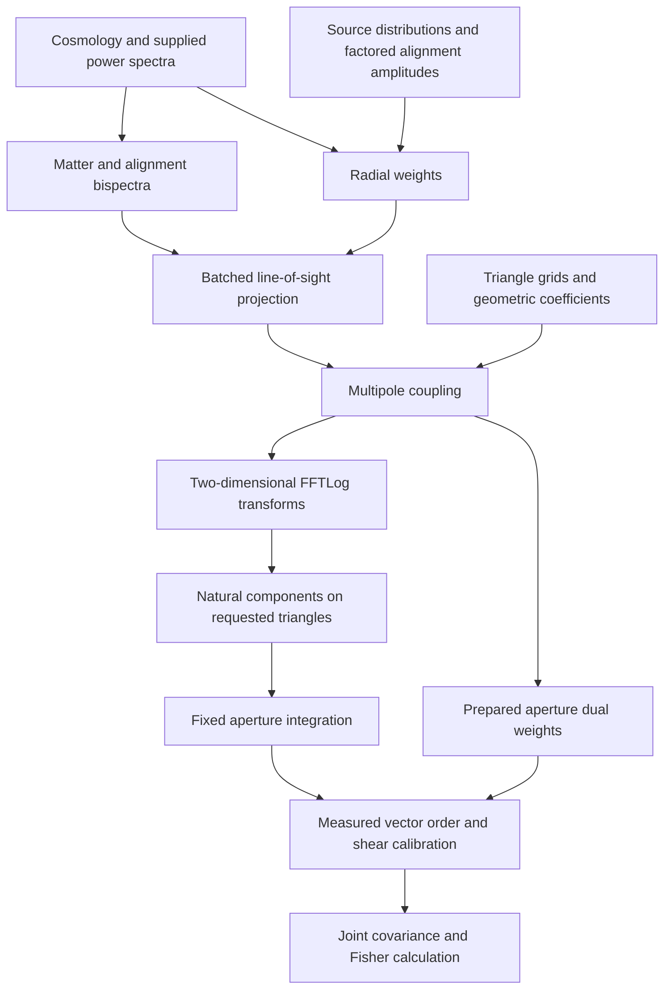

# A C implementation organized around reusable calculations

> **Archive status.** This source study records design proposals and validation requirements, not completed features. Read the [maintained implementation status](../threepcf.md) first. Both the mean and its covariance belong in `cosmolike/3pcf/`; earlier destination proposals using `fastnc/` or `covariances/` are superseded.

The recommended design is a new `cosmolike/fastnc/` module for three-point predictions, with survey configuration and Fisher orchestration outside the numerical kernels. It should preserve Sunao Sugiyama's multipole method and Rafael Gomes's physical models, while changing how shared work is computed, stored, and distributed across processor cores. The source review identifies enough independent work to justify this project. A reduction from tens of seconds to a few seconds is a reasonable **engineering target to test**, rather than a measured outcome of this study.

The comparison must include the direct TATT-branch calculation, current main where it implements the same physics, the proposed C calculation, and the existing upstream emulator when its training domain covers the question. Main contains numerical corrections and alternative algorithms that make it a separate comparison, as explained in [Chapter 9](09_main_branch_reconciliation.md). The emulator already bypasses much of the direct calculation. A C implementation has value as a checked reference, a training-data generator, a predictor outside an emulator's fixed filters, and a source of controlled Fisher derivatives even if it does not beat a trained network in evaluation time. [Rafael's Y6 package](10_desy6_workflow.md) supplies an existing interface through which to compare these calculations for separately specified Y3 and Y6 forecasts.

## 1. The calculation should expose its physical stages

Consider a prediction for three source redshift bins and a set of angular triangles. First compute distances, growth, power spectra, and the matter and alignment bispectra. Project these three-dimensional bispectra along the line of sight. Expand the projected triangle dependence in angular modes, convert those modes into the four shear natural components, and integrate the components with aperture filters if the requested output is aperture skewness. Each stage has different input dependencies. Keeping those dependencies visible is the basis of the proposed acceleration.



The diagram places the factored alignment amplitudes in the radial weights; the bispectrum stage supplies their physical basis functions. A direct implementation that keeps the amplitudes inside each bispectrum must instead track them there. The two aperture paths are proposed alternatives that must agree for the same estimator. The natural-component path remains necessary to reproduce the triangle-dependent results of the TATT paper. An aperture-only shortcut cannot replace that reproduction target.

Suggested future file responsibilities are below. These are design names; this study creates none of these implementation files.

| Proposed file or layer | Responsibility | Scientific boundary |
|---|---|---|
| `fastnc/README.md` | Physics introduction, credits, units, configuration, examples | Identify the inherited algorithms and the validated observables |
| `bispectrum_fastnc.c` | Matter bispectrum and its cosmology-dependent tables | Keep the publication's BiHalofit choice separately selectable from later models |
| `ia_fastnc.c` | Ordered alignment bispectra and amplitude conventions | Preserve field order, redshift dependence, and the velocity-shear convention |
| `projection_fastnc.c` | Radial weights and batched projections | Own quadrature accuracy and source-distribution dependencies |
| `multipoles_fastnc.c` | Angular expansion and geometric mode coupling | Document every symmetry used to reduce the calculation |
| `fftlog_fastnc.c` | Two-dimensional transforms, reusable plans, work arrays | Own FFT normalization, phase, padding, and boundary treatment |
| `aperture_fastnc.c` | Natural-component integration and reusable aperture weights | Match the actual finite triangle domain and angular averaging |
| `state_fastnc.c` | Allocation, dependency tracking, teardown | Keep model state separate from worker scratch |
| Thin C++ bindings | Transfer arrays and settings between Python and C | Avoid calling Python once per triangle or integration node |
| Project-level Python | Survey files, masks, priors, Fisher jobs, result metadata | Keep the scientific run specification readable |

Covariance extensions should remain under the existing `cosmolike/covariances/` ownership. The mean prediction module can provide spectra or responses to that layer, but should not silently generate a covariance during every likelihood evaluation. The CPU port is a separate deliverable: [Chapter 15](15_analytic_covariance_cpu_port.md) identifies the upstream covariance code and derives reductions of selected terms, while [Chapter 17](17_cosmolike_covariance_cpu_transfer.md) maps actual core covariance mechanisms to that calculation. A small set of named structures and explicit calculation stages fits the current C style.

The prepared aperture path can bypass repeated FFT execution after fixed measurement weights have been moved backward through those linear stages. Its construction, memory requirement, and nonlinear boundaries are specified in [Chapter 21](21_further_execution_and_cache_design.md). Full-filter analytic alternatives are derived separately in [Chapter 20](20_further_data_vector_reductions.md). The ordinary natural-component path remains available for the paper's triangle-dependent predictions and for independent comparisons.

## 2. Compute matter and alignment terms once per physical point

The main reuse opportunity is shared physics across tomographic combinations. At a fixed cosmology, a matter bispectrum evaluated at a particular redshift and triangle does not know which observed source bins will later weight it. Computing it again for every source triplet wastes that independence. The current matter interpolation path already uses this fact; the TATT path deserves the same factoring, with ordered alignment fields retained. See the [source audit](02_upstream_source_audit.md) for the actual call paths. The transverse tree-level identity in [Chapter 12](12_second_pass_physics.md) also permits one shared quadratic shape kernel with separate coefficient weights. It does not permit identifying the two quadratic parameters throughout a joint survey model.

Write a projected component schematically as

```math
B^{ijk}_a(\ell_1,\ell_2,\ell_3)
\simeq \sum_{r=1}^{N_\chi}
  w^{ijk}_{a,r}\,
  b_a\!\left(\frac{\ell_1}{\chi_r},
             \frac{\ell_2}{\chi_r},
             \frac{\ell_3}{\chi_r},z_r\right).
```

Here `i,j,k` label source bins, `a` identifies an ordered physical component such as density–density–intrinsic-shape, and `r` labels a radial quadrature node. The weight includes the quadrature measure, the appropriate lensing or source-density factors on each leg, and the distance denominator. The expensive three-dimensional quantity is `b_a`. For shared alignment coefficients, it can be computed once and contracted with many bin weights. If alignment coefficients differ between source bins, first separate their amplitudes from the geometric kernels; otherwise the proposed reuse is no longer exact.

At tree order, the alignment expansion contains a finite set of amplitude products. Expressing it as

```math
b_a(\boldsymbol{k},z)
=\sum_{q=1}^{N_{\rm basis}} c_{a q}(z)\,K_{a q}(\boldsymbol{k},z)
```

makes those products explicit. `K` contains the triangle dependence and the chosen power-spectrum products; `c` contains the corresponding alignment amplitudes. The label `q` enumerates terms derived from the equations, not an arbitrary fitted basis. An amplitude-only change can then update short sums rather than recomputing every triangle. Redshift exponents still change the coefficients at every radial node. Cosmological changes still change the spectra and distances. This decomposition should be derived and checked term by term before deciding the number of stored arrays.

The same argument applies to the triangle geometry inside one physical evaluation. Side ratios, dot products, orientation factors, and the rotated wavevectors recur in several alignment components. Compute them once for a block of triangles and use them across those components. This is a stronger C opportunity than translating each existing Python helper into an independent C function that reconstructs the same vectors.

## 3. Preserve the transform reuse that already exists, then extend it

`FastNaturalComponents.compute` already constructs one `two_Bessel` object per angular mode and uses it for several natural components. The object's forward transform is shared across those components. A port must retain that reuse; counting four eliminated forward transforms per mode would overstate the opportunity. The relevant source is [the pinned transform driver](https://github.com/git-sunao/fastnc/blob/7b2336ce37a909bed51f07f32a2a4f096e71b6ce/fastnc/fastnc.py#L322).

The additional opportunities are to retain FFT plans across evaluations, precompute transform factors that depend only on the grids and Bessel orders, batch independent transforms, and remove repeated construction of temporary arrays. The radial projection can also be organized so that one block of bispectrum values feeds several tomographic outputs before leaving the processor cache. These changes affect different stages and should be evaluated separately.

For the supplied configuration with `Mmax=100`, a direct reading of the mode loop gives 101 nonnegative angular modes per sample combination. With all four natural components, the nominal workload is one forward and four inverse two-dimensional transforms per mode, before any additional symmetry reduction. If 20 unordered source triplets are evaluated, that is 2,020 forward and 8,080 inverse transforms. These are **operation counts for that configuration**, not a claim about the settings of the published 40-second run. Grid tuning can also change the actual FFT dimensions from the nominal `nfft` setting.

## 4. Threading opportunities can be established before timing

OpenMP assigns independent pieces of a calculation to workers sharing one address space. The useful unit of work here is an output block whose inputs have already been initialized and whose temporary arrays belong to one worker. SIMD operates inside such a block: one processor instruction applies the same arithmetic to several array elements. These are two different levels of parallelism and can be combined.

| Calculation stage | Candidate work item | Shared read-only inputs | Worker-owned writes | Condition to establish before timing |
|---|---|---|---|---|
| Bispectrum preparation | A block of triangles at one or several redshifts | Spectrum tables, model coefficients | Triangle geometry and bispectrum block | No lazy initialization or mutable interpolation accelerator in the worker |
| Line-of-sight projection | A triangle block and a group of source triplets | Radial weights, current physical block | Output integrals | Each output has one owner and a fixed radial summation order |
| Angular expansion | A radial-scale block or source triplet | Basis values and quadrature weights | Multipole rows | Component and leg labels survive any symmetry reduction |
| Mode coupling | A mode and triangle block | Geometric coupling coefficients | Coupled input to FFTLog | No shared scratch and no nested worker teams |
| FFTLog | A source triplet and angular mode | Compatible FFTW plans and transform factors | Aligned transform buffers | Plans built serially; each execution uses its own arrays |
| Natural-component reconstruction | A triangle block | Mode coefficients and angular exponentials | Complex component values | Writes do not overlap and summation order is specified |
| Aperture contraction | An aperture and source triplet | Fixed integration weights | Final scalar or vector entry | Weight matrix matches the selected measurement domain |
| Fisher derivative campaign | A parameter displacement | Immutable survey specification | A process's own cosmological state | Different cosmologies do not share CosmoLike globals |

The source-level case for ten-core parallelism is strong: even a single triplet with many modes supplies many independent transform jobs. The practical questions are how large each job is, whether workers compete for memory bandwidth, and which stage limits the total. A schedule that repeatedly starts worker teams for tiny loops can lose time despite having independent work. Grouping tasks into one persistent calculation phase and assigning whole output rows follows the existing CosmoLike approach.

The current core's FFT strategy is especially relevant. The inspected paths create plans serially and execute independent transforms under OpenMP. They do not establish a precedent of enabling a ten-thread FFTW team inside every OpenMP worker. FFTW permits concurrent execution of a shared plan on compatible separate arrays, with restrictions on shape, strides, placement, and alignment. Those restrictions belong in the design and tests. [FFTW execution rules](https://www.fftw.org/fftw3_doc/New_002darray-Execute-Functions.html)

Start with outer OpenMP and one FFT execution per worker. Later compare this with a small number of workers using internally threaded FFTs for large transforms. Do not combine ten outer workers with ten FFT threads by default: that requests roughly one hundred runnable threads before counting any BLAS team. The FFT library itself recommends choosing thread counts according to transform size and measured overhead. [FFTW threading guidance](https://www.fftw.org/fftw3_doc/How-Many-Threads-to-Use_003f.html)

## 5. What a ten-core target means quantitatively

Let $`T_1`$ be the time of a specified one-core calculation, and let $`p`$ be the fraction that can run concurrently. Ignoring scheduling and memory overhead, ten equal cores give

```math
T_{10}=T_1\left[(1-p)+\frac{p}{10}\right].
```

The first term remains serial. The second shares the independent work among ten cores. The following arithmetic assumes a hypothetical one-core time of 40 seconds. The thread allocation behind the user's starting estimate has not been verified; if that run already used parallel execution, its time cannot be divided by ten again. No timing was performed for this study, and the published four-bin timing is not a measurement of the inspected TATT revision.

| Assumed parallel fraction | Ideal ten-core time from 40 s | Ideal speedup |
|---|---:|---:|
| 90% | 7.60 s | 5.26 |
| 95% | 5.80 s | 6.90 |
| 99% | 4.36 s | 9.17 |

C loop fusion, fewer allocations, shared physical calculations, and SIMD can reduce the work before it is distributed. For example, if 95% of a 40-second workload becomes three times cheaper per core and is then shared among ten cores, while the other 5% stays unchanged, the arithmetic gives about 3.27 seconds. That is a conditional scenario, not a predicted benchmark. Multiplying a nominal SIMD width by ten cores would not be justified: some upstream NumPy operations already execute compiled vector loops, FFT libraries already have optimized kernels, and memory traffic can set the limit.

The useful performance hypotheses are therefore concrete: C should reduce temporary-array traffic; batching should remove repeated geometry and bispectrum evaluations; OpenMP should distribute the independent output blocks; and SIMD should accelerate the remaining contiguous arithmetic. The [CosmoLike chapter](03_cosmolike_patterns.md) explains where the existing code demonstrates those mechanisms.

## 6. Bound memory before choosing the loop order

A complex double-precision square buffer uses $`16N^2`$ bytes. For `N=256`, this is 1 MiB; for `N=512`, it is 4 MiB. Ten workers each holding eight such buffers require about 80 or 320 MiB respectively, before spectra, coupling coefficients, output vectors, or allocator padding. These are illustrative storage calculations, not measured peak memory.

Storing every intermediate for every redshift, triplet, component, and angular mode can cost much more. For example, 20 triplets, 51 multipoles, and a 150-by-150 real grid require about 184 MB for a single eight-byte scalar table. Seven ordered IA components increase that to about 1.29 GB. Adding a radial axis multiplies the storage again. A design that computes one radial or triangle block, contracts it into all relevant outputs, then reuses the work arrays avoids that multiplication.

The preferred layout puts the index traversed by the innermost loop next to itself in memory. If a worker processes neighboring triangles, store the same physical quantity for those triangles contiguously. Separate arrays for real and imaginary values can help arithmetic kernels; FFTW's interleaved complex layout can be used at the transform boundary. The choice needs a stated conversion cost. Avoid several simultaneous copies solely to make every stage convenient.

## 7. Aperture-only evaluation offers another algorithmic reduction

For fixed angular bins and filters, integration of the natural components is a linear operation. If $`g`$ stacks their real and imaginary entries and $`A`$ is the matrix of aperture weights, the prediction is $`m=A g`$. The weights include angular measures, orientation factors, finite limits, and the component combination. The historical integrator constructs such factors during `calculateMap3`; retaining them across cosmologies is a saving relative to that path. Rafael's Y6 package already caches the aperture matrix. The C comparison against that package must preserve its reuse and measure any further benefit from contraction layout or combining operators. [Historical aperture calculation](https://github.com/rchgomes/3pcf_integrator/blob/d6098d326dcb03bc750adcc9627119f52d928944/python/fast_map3.py#L119), [Y6 implementation](10_desy6_workflow.md)

There is a further possibility. If $`g=R h`$, where $`h`$ stacks real and imaginary parts of transformed multipoles and $`R`$ reconstructs angular dependence, compute $`A R`$ once and apply it directly to $`h`$. This can avoid constructing a large array of natural components on opening-angle bins merely to sum it down to four Y3 or five Y6 equal-aperture values per source triplet. The proposed operator must retain the finite triangle domain and the same angular averaging as the measured statistic. Its cache must also track grid tuning, interpolation, downsampling, and measurement weights. A continuous, infinite-domain aperture integral is a separate observable if the measurement excludes some triangles.

A direct Fourier-space aperture integral is also worth retaining as an independent check. For an isotropic compensated filter with Fourier transform `Ũ`, the E-mode statistic contains an integral of the convergence bispectrum multiplied by three `Ũ` factors. That path may be economical for a few fixed apertures. It cannot be assumed equivalent to a measurement formed from truncated and binned three-point correlations. First compare it in the untruncated limit, then explicitly account for the measurement operator. This distinction is both a numerical test and a way to decide whether an aperture-only production mode is justified.

## 8. Cache validity follows physics, not object identity

Use three lifetimes. Geometric tables depend on numerical grids, Bessel orders, projection convention, and measurement bins. Cosmology tables depend on spectra, distances, growth, matter-field convention, and any baryonic parameters. Source weights depend on the redshift distributions and alignment parameters, and also on cosmology through distances, radial Jacobians, lensing prefactors, and growth-dependent amplitudes. A cosmological change therefore invalidates those weights as well as the spectra. Keeping these dependency groups explicit allows, for example, a shear-calibration change to touch only the final vector without confusing storage lifetime with physical independence.

Allocation and refill are different operations. Changing the number of bins or worker count can require a different allocation even when all physical parameters are unchanged. Changing a source distribution can require new values without a new allocation. Both must have explicit checks. Pointer equality does not prove that an input array's values are unchanged, and a cached answer must never survive an unrelated second likelihood merely because the new arrays have the same size.

A process that evaluates different cosmologies sequentially needs reliable reset and invalidation. Running different cosmologies concurrently inside one process needs independent model contexts, which the existing global CosmoLike state does not supply by default. For Fisher work, separate processes are the initial solution. Compare, on the same total core allocation, one process with ten OpenMP workers, two processes with five workers, and more processes with fewer workers. The best throughput for a derivative campaign need not coincide with the shortest single-vector latency.

## 9. SIMD should preserve an explanation of the equation

The arithmetic kernels should have a scalar mathematical description next to their vector form. A student should be able to identify which array contains a power spectrum, which contains a geometric coefficient, and which index visits triangles. SIMDe can express portable vector operations in the style already used by CosmoLike. It does not make scattered memory access cheap or justify changing floating-point rules.

Retain the current strict floating-point build. A SIMD pragma is a request, not evidence of vector instructions; later inspect compiler reports and generated instructions. Use independent scalar calculations in external validation, including lengths that leave one, two, or three elements after a vector block. Fixed output ownership and fixed reduction order are preferable where reproducibility matters. If a changed operation order creates small rounding differences, quantify them in the full vector and in Fisher derivatives rather than silently lowering the acceptance standard.

The recommendation is to pursue a C implementation with OpenMP and SIMD, beginning with shared physical work and a transparent task layout. The actual speed claim comes after these dependencies have been checked and the implementation has passed matched-accuracy tests on a quiet machine.
