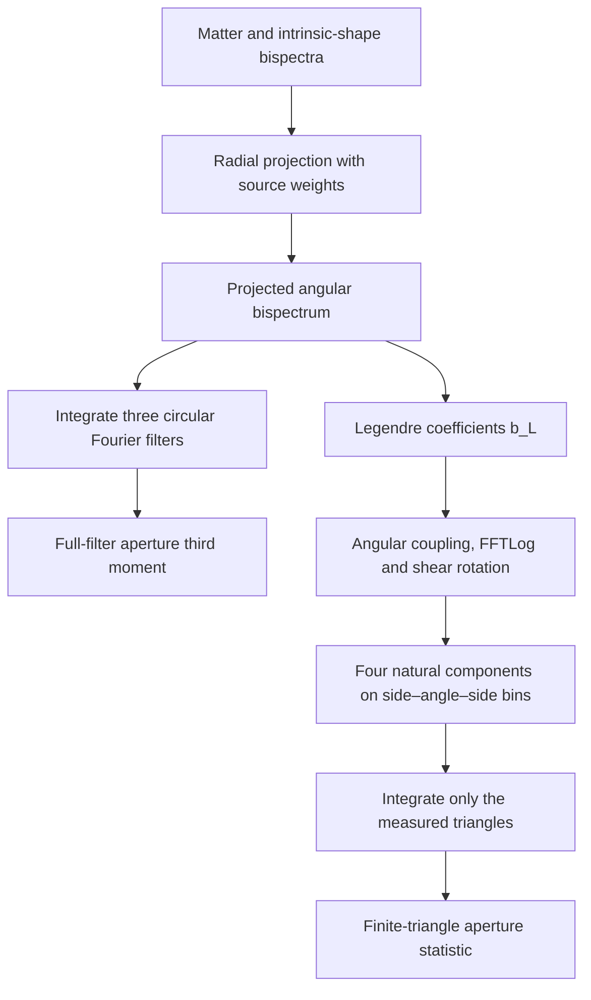

# Three-point shear and aperture statistics

1. [What can be calculated?](#scope)
2. [From matter and galaxy shapes to angular statistics](#physics)
3. [Angular multipoles and the four shear components](#transform)
4. [From galaxy shapes to aperture mass](#aperture)
5. [What the covariance components mean](#covariance)
6. [A joint two- and three-point Fisher calculation](#fisher)
7. [Files and the two C++ adapters](#files)
8. [Arrays, units and reuse](#arrays)
9. [Preparation, interpolation and parallel work](#preparation)
10. [Changing a calculation without restarting Python](#state)
11. [Accuracy and independent checks](#checks)
    1. [Accuracy controls](#accuracy-controls)
    2. [Individual stages](#accuracy-stages)
    3. [Shared smoothing controls](#shared-smoothing)
12. [Paired baryonic responses](#paired-feedback)
13. [A supplied matter bispectrum](#supplied-bispectrum)
14. [Acknowledgements](#credits)
15. [Matter fraction and expansion history](#matter-fraction-and-expansion-history)
16. [Upstream interpolation comparisons](#upstream-interpolation-comparisons)
17. [Relation to the ordinary radial kernels](#relation-to-the-ordinary-radial-kernels)
18. [Why the physical-model file remains](#why-the-physical-model-file-remains)

## What can be calculated? <a name="scope"></a>

Weak gravitational lensing slightly distorts the images of distant
galaxies. Two galaxies can have correlated distortions because light from
both passes through some of the same foreground matter. A two-point
statistic measures that correlation as a function of their separation.
A three-point statistic asks how three distortions correlate as a function
of the triangle formed by the galaxies.

Triangle shape matters: three nearly aligned positions and an
equilateral arrangement sample structure in different ways.

A Gaussian random field is completely specified by its mean and two-point
correlation; for a zero-mean Gaussian field the three-point correlation
vanishes. Gravitational evolution makes the matter field non-Gaussian:
dense structures grow and couple Fourier modes. The three-point function
measures part of that extra structure.

The parameter dependence of the three-point function can differ from that
of the two-point function, which can help separate cosmology from
uncertain galaxy-shape physics. The gain depends on their shared
covariance and on the model assumptions; additional array entries alone
do not establish additional independent information.

This directory predicts those means and their joint covariance under
stated estimator assumptions. It sits beside `covariances/` and leaves
the existing data-vector C files unchanged. Its physical inputs are
matter power spectra, distances, growth and the redshift distribution of
each source-galaxy sample, together with the cosmological and
intrinsic-shape parameters. An optional CAMB producer in the companion
project calculates the power and background tables. The C functions read
those tables; they do not run a Boltzmann solver.

The following table maps the calculation. The next sections define its
physical quantities before introducing their storage and interfaces.

| Implemented calculation | Input | Result |
|---|---|---|
| Supplied matter and intrinsic-shape bispectra | Theory B, physical tables, triangle sides and IA coefficients | Matter-table reads and 19 active TATT/velocity-shear components |
| Radial projection and angular multipoles | Physical model and an ordered source-bin triplet | Projected E bispectrum and its Legendre coefficients |
| Natural-component transform | Legendre coefficients and fixed geometry | Four complex shear correlations, using two-dimensional FFTLog |
| Full-filter aperture mean | Projected bispectrum, three filters and fixed Fourier quadrature | Third moment for the unrestricted circular-filter estimator |
| Finite-triangle aperture weights | Two side grids, opening angles and three radii per output | Reusable complex integration weights |
| Aperture contraction | Weights and four complex natural components | One aperture moment per sample and radius triplet |
| Physical joint covariance | Matter model, Sheth–Tormen/Navarro–Frenk–White halo model, noise, rows and quadratures | Separate Gaussian, BB, PT, PB, connected and long-mode terms |
| Filtered pair correlations | Angular power, two Fourier filters and an explicit quadrature | Correlation of two filtered fields at each separation |
| Gaussian cubic-map covariance | Filtered pair functions and centre-separation weights | All fifteen Gaussian six-field contractions |
| Connected response contraction | Observable responses and nonnegative integration weights | A symmetric Gram matrix |

The physical covariance constructs its own halo profiles and responses.
It describes full-filter map estimators that average aperture centres
over a circular or square window. Catalogue masks, distinct-galaxy
exclusions and finite triangle selection need different estimator
calculations, and the halo model carries no nonlinear
intrinsic-alignment connected covariance. The
[physical covariance guide](COVARIANCE.md) explains these limits with
the equations.

The companion DES project (`Cocoa/projects/des_3pcf/README.md`) owns
builds, survey-file readers, model preparation and Fisher calculations.
It follows the `lsst_y1` separation of core numerics, project
registration and tests, and it keeps the full two-point vector next to
the three-point rows. Predicted means and analytic covariances define a
forecast; reproducing a published posterior additionally needs that
analysis's data, cuts, priors and likelihood choices. No survey accuracy
or measured speedup follows from the component tests alone.

Readers interested in the observable can follow Sections 2–6 without
reading the C++ interfaces. To change the implementation, continue
through the ownership and numerical sections, then read the relevant
source header from Section 7 and its function comments.
[NUMERICS.md](NUMERICS.md) gives the table and integration rules.
[COVARIANCE.md](COVARIANCE.md) gives the full physical covariance
construction and its estimator restrictions.

## From matter and galaxy shapes to angular statistics <a name="physics"></a>

### The matter field and its bispectrum

Write the fractional matter-density fluctuation as
$`\delta=(\rho-\bar\rho)/\bar\rho`$. Its power spectrum $`P(k,z)`$
describes pairs of Fourier modes. Its bispectrum $`B_m`$ describes triples:

```math
\left\langle\delta(\boldsymbol k_1,z)
\delta(\boldsymbol k_2,z)\delta(\boldsymbol k_3,z)\right\rangle
=(2\pi)^3\delta_D(\boldsymbol k_1+\boldsymbol k_2+\boldsymbol k_3)
B_m(k_1,k_2,k_3;z).
```

The Dirac delta enforces translation invariance: the three wavevectors
must close into a triangle. Their lengths $`k_1,k_2,k_3`$ therefore obey
the triangle inequalities. A larger $`k`$ means a smaller spatial scale.
The theory provider always supplies the full matter bispectrum through
a [required table](#supplied-bispectrum). The project theory block implements
BiHalofit; the C projection library does not contain a second matter fit. A
separate tree-level result supplies the lowest-order gravitational
perturbation-theory reference. Both the fit and the tree-level result are
physical approximations, and increasing a numerical resolution does not
make either of them exact.

The model accepts $`k`$ in $`h/\mathrm{Mpc}`$, distances in
$`\mathrm{Mpc}/h`$, power in $`(\mathrm{Mpc}/h)^3`$ and bispectra in
$`(\mathrm{Mpc}/h)^6`$. Here $`h=H_0/(100\,\mathrm{km\,s^{-1}Mpc^{-1}})`$
specifies the present expansion rate.

Growth $`D(z)`$ describes the linear fluctuation amplitude, normalized
by $`D(0)=1`$. The ordinary core's growth table stores a quantity
proportional to $`D/a`$ instead, where $`a=1/(1+z)`$ is the scale
factor; the project bridge makes that conversion explicitly.

Source arrays are probability densities per unit redshift. The code
normalizes each curve on the grid the caller passes. A normalized source
curve describes where galaxies lie, not how many there are; the source
number density needed for shape noise is a separate survey input.

### Projecting along the line of sight

The model uses spatially flat lensing geometry. The provider must establish
flat geometry before supplying distances, power and bispectra. The project
CAMB producer explicitly requests it. A curved-cosmology distance table
cannot make this projector consistent with curvature: the lensing kernel
still uses the flat-space distance ratio. C reads the supplied background
arrays and does not infer density fractions or curvature from them.

Convergence $`\kappa`$ is the scalar lensing field obtained by weighting
matter fluctuations along the line of sight. Its angular variations also
produce shear. For gravitational lensing, the flat-sky Limber projection is

```math
B_\kappa^{ijk}(\ell_1,\ell_2,\ell_3)
=\int d\chi\,\frac{W_i(\chi)W_j(\chi)W_k(\chi)}{\chi^4}
B_m(\ell_1/\chi,\ell_2/\chi,\ell_3/\chi;z(\chi)).
```

Here $`\chi`$ is comoving radial distance and $`W_i`$ is the lensing
efficiency of source sample $`i`$, with units of inverse distance. A
source sample has a broad redshift distribution, so a single angular
triangle receives contributions from many foreground distances.
$`W_i`$ weights each distance by the amount of sample $`i`$ behind it
and by the lens–source geometry.

The three efficiencies appear because the same foreground fluctuation
lenses all three source samples. The source labels $`i,j,k`$ specify a
tomographic triplet: tomography means dividing the galaxies into samples
by their estimated redshift.

Limber assigns a transverse spatial wave number $`k=\ell/\chi`$ to an
angular multipole $`\ell`$; larger multipoles describe finer angular
structure, and the same angular mode probes smaller physical structures
at a smaller distance. A units check gives
$`d\chi\,W_iW_jW_k\chi^{-4}B_m`$ units
$`L\,L^{-3}L^{-4}L^6=1`$, as required for a correlation of
dimensionless lensing fields.

The implementation keeps the source convention with no $`\ell+1/2`$
substitution. Its internal radial tables store fastnc's rescaled
kernels, not the bare $`W_i`$; the covariance code converts those tables
before using the physical powers of distance.

### Intrinsic shapes and ordered source labels

The observed shape contains both the lensing distortion $`G`$ and an
intrinsic contribution $`I`$. The latter can correlate with the tidal
field where the galaxy formed. Expanding a three-shape product gives
$`GGG`$, three placements of $`GGI`$, three placements of $`GII`$ and
$`III`$. A lensing leg weights foreground matter through $`W_i`$; an
intrinsic leg instead selects the source population at the local
distance. Exchanging these legs changes their radial weights.

TATT means tidal alignment and tidal torquing. It includes a response
linear in the tidal field and responses quadratic in that field, with a
density-weighting term; the density weighting accounts for sampling
shapes at galaxy positions rather than uniformly through space. The
optional velocity-shear contribution is a further intrinsic-shape
response.

The low-level IA calculation returns nineteen components: seven contain
only density and intrinsic E fields; twelve contain one intrinsic B
field. Here E and B label the two shear patterns: E is the pattern a
scalar lensing potential produces, and B is the independent rotated
pattern. The projected mean contracts only the first seven, following
the E-only numerical calculation of Gomes et al.
([arXiv:2601.09133](https://arxiv.org/abs/2601.09133)).

The single-B components remain available for separate diagnostics; their
natural-component transform is not part of this mean. Each amplitude and
redshift law belongs to its own Fourier leg and source label.

The nonlinear-alignment (NLA) baseline keeps a shape response linear in
the tidal field while using the nonlinear matter correlations. Its
linear response amplitude is $`C_1`$. This deterministic part replaces
each lensing efficiency by its lensing-plus-linear-alignment value, and
the residual TATT terms are then added without counting that baseline
again.

The upstream baseline and residual source kernels follow different
normalization and interpolation sequences, and they stay separate here:
combining their continuous formulas does not prove their finite
numerical grids are equivalent.

Two settings choose the IA power and the velocity-shear normalization:

- `power_mode: 0`: use linear $`P(k,0)D^2`$.
- `power_mode: 1`: use the upstream nonlinear $`P(k,0)D^2`$ prescription.
- `power_mode: 2`: use the evolving nonlinear table the caller passes.
- `ct_mode: 0`: define the physical velocity-shear coefficient as
  $`C_t=C_1\,ct`$.
- `ct_mode: 1`: take `ct` itself as that coefficient.

The mean's three-point IA model predicts E-mode correlations, which
suffices for ideal E-mode aperture moments. A finite aperture integral
over measured triangle bins can mix E and B contributions, and leakage
from the omitted single-B bispectra has not been quantified. Those
bispectra exist at the tree order kept here; bispectra with two B legs
first enter at higher order under the deterministic model's
Gaussian-initial-field assumptions.

The companion joint mean obtains two-point TATT E/B spectra from the
ordinary CFASTPT routines, which evaluate the perturbative convolution
integrals for that two-point model. The two statements concern different
orders of correlation and must not be interchanged. Likewise, the
BiHalofit baryon-response option changes a matter bispectrum; it does
not by itself define a two-point feedback spectrum or modify the halo
profiles used in the covariance.

### Separating operators and galaxy placements

A diagnostic can ask either which intrinsic galaxies contribute or which
physical shape response produces their correlation. Two selectors in an
IA dictionary answer these questions before integration:

- `operator_component: 0`: keep the complete calculation (default).
- `operator_component: 1`: keep the nonlinear-alignment baseline.
- `operator_component: 2`: keep density weighting.
- `operator_component: 3`: keep tidal torque.
- `operator_component: 4`: keep velocity shear.
- `intrinsic_legs: -1`: keep every galaxy placement.
- `intrinsic_legs: 0` to `7`: read bits 0, 1 and 2 as intrinsic shapes
  on the corresponding ordered source legs.

The baseline includes gravity until a placement is chosen. The
placements map to `intrinsic_legs` values as follows:

| Placement | GGG | GGI | GIG | IGG | GII | IIG | IGI | III |
|---|---|---|---|---|---|---|---|---|
| `intrinsic_legs` | 0 | 4 | 2 | 1 | 6 | 3 | 5 | 7 |

For example, `operator_component=3, intrinsic_legs=4` selects tidal torque
with the intrinsic shape on leg 3. These selectors work through both C++
adapters, direct projection, prepared grids, multipoles and aperture
transforms. The leg selector applies to projection; the unprojected IA
method continues to return its nineteen explicitly ordered entries.

The tensor basis coefficient of the density-shaped vertex is
$`C_{1\delta}-2C_2/3`$, where $`C_2`$ is the tidal-torque amplitude
normalization and $`C_{1\delta}=b_{\rm TA}C_1`$, with $`b_{\rm TA}`$ the
tidal-alignment bias. A torque-only calculation must therefore keep both
the quadratic coefficient $`C_2`$ and the density-shaped coefficient
$`-2C_2/3`$. A density-weighting calculation keeps only $`C_{1\delta}`$.
Every residual keeps its factors of $`C_1`$ on the other intrinsic legs.
This gives a physical operator split without subtracting nearly equal
total predictions.

Prepared component grids require `signed_baseline: 1`. They interpolate
signed components divided by one common positive GGG scale; taking the
logarithm of an individual signed component is undefined and would also
break additive closure. The code splines the baseline's G and I kernels
separately on the same original kernel grid, and the residual keeps its
own source-grid weights. Each projector owns its weights and
coefficients, so a component call cannot alter a previously constructed
total grid.

The project's operator notebook
(`Cocoa/projects/des_3pcf/EXAMPLE_IA_COMPONENTS.ipynb`) returns
`[5,8,nrow]` signed moments: gravity, linear alignment, density
weighting, torque and velocity shear by the eight placements above. It
checks their sum against the ordinary total. Its first plot groups
physical operators; its second groups higher-order TATT placements,
excluding both linear alignment and velocity shear. This follows the
distinction drawn in Figures 5 and 6 of
[Gomes et al.](https://arxiv.org/abs/2601.09133).

The velocity-shear diagnostic implements the vertex that the upstream
code evaluates. In the equilateral limit it gives
$`B_{\delta\delta E}^{VS}=-3C_t P^2/14`$ and no single-B velocity-shear
term. The velocity-shear vertex equations of Gomes et al.
([arXiv:2601.09133](https://arxiv.org/abs/2601.09133)), Eqs. 62 and 67
as printed, differ from this result. The manuscript/code convention
difference is unresolved, so the velocity-shear curves must not be
called an independently validated reproduction. The TATT equilateral
identity $`B_{\delta\delta E}^{res}/P^2=-C_2/6-C_{1\delta}/2`$ is tested
separately and agrees with the operator calculation.

## Angular multipoles and the four shear components <a name="transform"></a>

The angular bispectrum still depends on the size and shape of a Fourier
triangle. For fixed $`\ell_1,\ell_2`$, the source convention defines
$`\mu`$ by $`\ell_3^2=\ell_1^2+\ell_2^2-2\ell_1\ell_2\mu`$.
Legendre polynomials $`P_L`$ are an orthogonal basis on $`[-1,1]`$.
Expanding in that basis separates the shape dependence:

```math
B^{ijk}(\ell_1,\ell_2,\mu)
\simeq\sum_{L=0}^{L_{\max}}b_L^{ijk}(\ell_1,\ell_2)P_L(\mu),
\qquad
b_L^{ijk}=\frac{2L+1}{2}\int_{-1}^{1}d\mu\,B^{ijk}P_L(\mu).
```

$`L`$ is a basis order for triangle shape, whereas $`\ell_1,\ell_2`$
are Fourier side lengths. Truncating at $`L_{\max}`$ is a numerical
approximation to refine. The minus sign in the definition of $`\mu`$
also fixes the $`(-1)^L`$ factor in the angular coupling. It cannot be
changed independently of that coupling.

Shear has two components, conveniently written
$`\gamma=\gamma_1+i\gamma_2`$. Rotating the axes by an angle changes
its phase by twice that angle; this is the meaning of a spin-two field.
Let $`g_a`$ denote the shear at vertex $`a`$ after rotating it into a
chosen triangle direction. The four natural components are

```math
\Gamma_0=\langle g_1g_2g_3\rangle,\qquad
\Gamma_1=\langle g_1^*g_2g_3\rangle,\qquad
\Gamma_2=\langle g_1g_2^*g_3\rangle,\qquad
\Gamma_3=\langle g_1g_2g_3^*\rangle.
```

They keep the orientation information needed to convert a shear
correlation into an aperture statistic. Both the complex phase and the
position of the conjugated leg matter. The same four arrays in another
rotation convention are different inputs to an aperture kernel.

The transform first couples the Legendre coefficients to angular Fourier
modes $`M`$. Two radial Bessel integrals then turn Fourier-side lengths
into angular separations. FFTLog evaluates those integrals using Fourier
transforms on logarithmic grids and analytic transforms of power laws.
Finally, the transform sums the modes with $`e^{iM\phi}`$ to recover the
opening angle $`\phi`$ and rotates the shears into the requested
projection.

A transform plan, once constructed, holds geometry, transform factors
and worker storage. Its input $`b_L`$ changes when the physical model
changes.

Source labels and triangle sides must move together. With unequal source
bins, ordered TATT coefficients need not be symmetric under exchanging
the two Fourier sides. `ordered_legs=True` therefore evaluates both
signs of angular mode $`M`$ explicitly; `ordered_legs=False` reproduces
the fastnc main-branch transpose shortcut for source comparisons.

Independent Cartesian Gaussian-moment tests check the general case as
well as the shear rotation toward the triangle centroid. The TATT
centroid phase passes that test; the conjugate phase of the fastnc main
branch stays available only as a comparison convention.

Logarithmic FFT grids have finite bounds and a periodic representation.
Padding and coefficient tapering control parts of the resulting
numerical error, and the plan offers both the tapered coefficient window
and the untapered upstream window as explicit choices for source
comparisons.

A radial-bin average uses the bin lower edges and the logarithmic width
the caller passes. An angular-bin average with positive `dphi` averages
the angular Fourier modes before applying the centroid phase at the bin
centre; it is not the exact bin average of that varying phase. These
choices must stay visible when comparing codes.

## From galaxy shapes to aperture mass <a name="aperture"></a>

Aperture mass averages projected matter fluctuations with a circular
filter whose integral is zero. A constant foreground sheet then gives
zero signal. For the Gaussian compensated filter used here, its Fourier
weight at angular multipole $`\ell`$ and radius $`R`$ is

```math
\widetilde U_R(\ell)=\frac{(\ell R)^2}{2}
\exp\left[-\frac{(\ell R)^2}{2}\right].
```

The observable returned is the E-mode third moment
$`\langle M_{\rm ap}(R_1)M_{\rm ap}(R_2)M_{\rm ap}(R_3)\rangle`$.
E modes have the shear pattern produced by a scalar lensing potential;
B modes describe the independent rotated pattern. The leading scalar
lensing model used here has no B-mode signal, although random shape noise
has both components. These statements do not remove the complex phases
of a three-point shear correlation.

### Full filters and measured triangle coverage

There are two routes to this moment. The full-filter route works directly
with the projected bispectrum:

```math
\langle M_1M_2M_3\rangle
=\int\frac{\ell_1d\ell_1\,\ell_2d\ell_2\,d\varphi}{(2\pi)^3}
B^{ijk}(\ell_1,\ell_2,|\boldsymbol\ell_1+\boldsymbol\ell_2|)
\widetilde U_{R_1}(\ell_1)\widetilde U_{R_2}(\ell_2)
\widetilde U_{R_3}(\ell_3).
```

Here $`M_a`$ is the aperture field of the source sample and radius on leg
$`a`$, and $`\varphi`$ is the angle between its two independent Fourier
vectors. The third vector closes the triangle. This formula uses the
usual vector sum; its $`\mu`$ in the Legendre convention above is
$`-\cos\varphi`$. The C `aperture_full` route needs no intermediate
$`b_L`$ or natural-component arrays. Its finite Fourier bounds are
numerical truncations of the unrestricted filter integral and must be
refined.

The finite-triangle route instead starts from shear correlations
available only in the measured side and opening-angle bins. It
integrates those natural components with four complex kernels. The
implementation uses the centroid convention of the published aperture
kernels: each shear is rotated relative to the direction between its
vertex and the triangle centroid. Components in another projection
change the answer even when every array dimension matches.

For example, a measurement that excludes all triangles with a side below
one arcminute cannot be turned into the unrestricted aperture moment by
increasing the density of its remaining bins. The missing region changes
the estimator. This is why the full-filter analytic covariance and a
finite-triangle mean need an estimator comparison before they are used
together. An aperture radius is a smoothing scale; it is not an angular
cut on each side of a galaxy triangle.

The project estimator guide (`Cocoa/projects/des_3pcf/ESTIMATOR.md`)
describes the original side-bin bank, the explicit cuts and the
representative-side choices. The optional `pixel_window` array holds
scalar $`W(\ell)`$ values at consecutive integer multipoles from zero.
Multipoles and aperture means include one window factor per Fourier leg.
Raw projected bispectra and the ordinary $`\xi_\pm`$ remain unsmoothed
building blocks. A physical model and each prepared grid own independent
copies, so a grid remains valid after its model is released.

The scalar HEALPix convention of this implementation reads the
TEMPERATURE column of the pixel-window file at `nside=1024` through
$`\ell=3071`$, with linear interpolation between integer multipoles and
zero above. HEALPix is the equal-area pixelization of the sphere used by
survey maps, and `nside` is its resolution parameter. The third-leg
window $`W_3`$ enters the angular integral; the windows $`W_1`$ and
$`W_2`$ apply after prepared-multipole interpolation, so support cannot
leak across their hard cutoff.

This scalar convention requires comparison with the actual shear
estimator. The analytic covariance does not apply these pixel factors
and refuses a pixel-smoothed model; a covariance from elsewhere needs
its own matching estimator definition. Refining the third-leg cutoff
inside the angular integral remains part of a survey-accuracy study.

The two paths share the physical bispectrum and separate at the observable:



### The finite side–angle–side integral

The finite grid describes a triangle by two side lengths $`d_2,d_3`$ and
the angle $`\phi`$ between them. SAS means side–angle–side. In units of
$`R_1`$, write $`s=d_2/R_1`$ and $`t=(d_3/R_1)e^{i\phi}`$. For logarithmic
side bins of common width $`\Delta\ln d`$ and linear angle bins of width
$`\Delta\phi`$, the integration measure is

```math
\frac{s^2\lvert t\rvert^2}{2\pi}
(\Delta\ln d)^2\Delta\phi.
```

The powers of the side lengths arise because a radial area element is
$`s\,ds=s^2d\ln s`$. The grids the caller passes contain bin
representatives; this is a finite quadrature, not an exact bin average
of the correlation.
The two side grids can have different numbers of bins but use the same
logarithmic width. Angles must lie strictly between zero and $`\pi`$;
collinear centroid projections are excluded.

For each output radius triplet, the prepared weights include this measure,
the sum with radii two and three exchanged, and the final factor one
quarter. The radius exchange implements the mirrored-orientation
convention of the DES Y6 aperture calculation. If $`W`$ denotes
those complete weights, the C contraction is simply

```math
\langle M_1M_2M_3\rangle_{\rm grid}
=\operatorname{Re}\sum_{\alpha=0}^3\sum_b W_{\alpha b}\Gamma_{\alpha b}
=\sum_{\alpha,b}
\left[\operatorname{Re}W_{\alpha b}\operatorname{Re}\Gamma_{\alpha b}
-\operatorname{Im}W_{\alpha b}\operatorname{Im}\Gamma_{\alpha b}\right].
```

Here $`b`$ visits measured triangle bins and $`\alpha`$ selects the natural
component. There is no complex conjugation in this multiplication. Do not
apply another factor one quarter after calling the contraction.

The adapter expects components already in this centroid and
component-order convention. In Rafael Gomes's Y6 backend, the conversion
from the fastnc output arrays is `-[Gamma0, Gamma1, Gamma3, Gamma2]`.
The C routine does not perform that conversion or infer the convention
from the data. The higher-level `TransformPlan.aperture_from_multipoles`
method performs the conversion before calling that same C contraction;
do not apply it again.

Finite triangle coverage can differ from the unrestricted aperture
integral and can cause E/B leakage. The routine returns the real
combination displayed above, not the full set of eight E/B aperture
combinations. Agreement with the upstream finite weights verifies this
numerical operation; it does not remove those physical distinctions or
establish a matching measured covariance.

A single-B control must preserve oriented triangles and ordered source
legs, vanish for the unrestricted E-aperture response, and then apply
the exact finite weights. Its size should be measured with the full
joint covariance. No nonzero correction for these weights has been
established; parity alone does not certify its absence.

## What the covariance components mean <a name="covariance"></a>

A model mean predicts the average measurement over possible realizations
of the Universe. Its covariance measures the scatter around that mean:

```math
\mathcal C_{IJ}=\left\langle
(\hat d_I-\langle\hat d_I\rangle)
(\hat d_J-\langle\hat d_J\rangle)\right\rangle.
```

A hat marks a measurement. A row label $`I`$ includes the statistic, source
samples and angular bin or filter radii. A diagonal entry is a variance;
an off-diagonal entry records fluctuations shared by two measurements.
The same massive halo can affect several source samples and aperture
radii, and both a two-point and a three-point measurement. This physical
overlap is why their cross covariance is required.

### From products of fields to covariance families

The covariance of two quadratic measurements contains four fields; that
of a quadratic and a cubic measurement contains five; that of two cubic
measurements contains six. A connected correlation, or cumulant, is what
remains after subtracting every product of lower-order correlations.

The four-field expectation therefore contains Gaussian pair products and
a connected four-field correlation, called a trispectrum in Fourier
space. The six-field expectation also contains products of two bispectra
and products of a power spectrum with a trispectrum. This is a
bookkeeping of distinct physical correlations, not six alternative
estimates of the same matrix.

The physical engine returns each of the following six families separately.
Here $`P`$, $`B`$ and $`T`$ denote power, bispectrum and connected
trispectrum ingredients after their required projections.

| Family | Physical content | Contributes to |
|---|---|---|
| Gaussian | Pair correlations of the signal and random shape noise | Two-point and three-point variances; the five-field cross block vanishes for zero-mean Gaussian fields |
| $`BB`$ | Products of two connected three-field correlations, after subtracting the product of the two means | Three-point covariance |
| $`PT_{1h}`$ | A pair correlation times the connected four-field correlation produced by one halo | Three-point covariance |
| $`PB`$ | A pair correlation times a connected three-field correlation | Two-/three-point cross covariance |
| Connected one-halo | Four, five or six fields produced by the same halo | Two-point, cross and three-point blocks |
| Long-mode response | A survey-scale density fluctuation changes the abundance of halos contributing to each observable | Two-point, cross and three-point blocks |

The matter model supplies the nonlinear projected power and the
BiHalofit bispectrum. The connected four-, five- and six-field parts use
one halo prescription: Sheth–Tormen abundance and bias, truncated
Navarro–Frenk–White density profiles, and an explicit concentration–mass
relation.

One-halo means that all fields in that connected contribution come from
one halo. It is an approximation to the full connected correlation: a
complete gravitational trispectrum, for instance, also contains
contributions involving several halos.

The long-mode family models the change in halo abundance. It is one
part of super-sample covariance, the modulation of measurements by
fluctuations larger than the observed patch; the abundance term does not
carry the growth, dilation, tidal and intrinsic-shape responses, so
calling it the complete super-sample covariance would overstate the
model. Two projected bispectra in $`BB`$ keep independent radial
integrals; their source weights cannot be forced to the same redshift
merely to reduce the work.

The covariance models gravitational lensing with Gaussian shape noise.
A TATT model of the mean does not supply the intrinsic-shape four-,
five- and six-field correlations that the covariance is missing. Using
this covariance with a TATT mean is therefore a fixed, lensing-only
covariance approximation, and the code makes that choice explicitly.

The covariance code also returns a `mean`. That vector is
gravitational only, and it exists so the covariance model can be
inspected. It is not the joint TATT prediction; that comes from the
separate mean engine.

Two further restrictions apply. First, the project covariance
requires a fiducial multiplicative shear calibration of zero. The
calibration can still vary in the Fisher mean while that covariance is
held fixed.

Second, the halo model inside the covariance treats all matter as one
pressureless fluid. It does not use the ordinary core's
cold-plus-baryon halo-formation prescription for massive neutrinos.
The project therefore rejects a nonzero neutrino mass unless the
single-fluid effective-growth approximation is chosen explicitly.

[COVARIANCE.md](COVARIANCE.md) states these assumptions and the exact
normalization of each term.

### Survey windows and random shape noise

The supported estimator averages full filtered maps over aperture centres,
or shear pairs over their midpoints. A circle or square weights those
centres. This window is distinct from holes in a galaxy catalogue inside
an aperture, and from the cuts that remove data-vector rows. Changing its
area does not reproduce either kind of selection. The `large_area`
option uses the large-footprint limit for short-mode contractions; the
long-mode contribution still uses the finite survey window.

For disjoint source samples, the white-noise angular power is
$`N^{ii}=\sigma_{e,\mathrm{component}}^2/n_i`$, where $`n_i`$ is the
number of galaxies per steradian and the dispersion
$`\sigma_{e,\mathrm{component}}`$ describes one ellipticity component.
Noise enters the pair correlations once; the code does not insert it
into the physical matter bispectrum or the connected halo cumulants.

An ideal white-noise field has a delta-function correlation, so its
two-point variance needs the actual angular-bin area; a finite list of
bin centres is not enough. One setting chooses the rule:

- `noise_mode: 1`: for large-area, uniformly area-weighted $`\xi_\pm`$
  bins, calculate the pure noise–noise term from the overlap of the
  exact annular edges, and keep numerical quadrature for the signal and
  mixed signal–noise terms.
- `noise_mode: 0`: use the finite-band rule the caller passes.

The annular correction does not extend to custom pair weights or finite
centre windows. Both E and B shape-noise components enter the shear
correlation covariance even when the lensing signal is pure E.

### Pair functions and the one-halo response

The lower-level routines also accept arrays from a physical model built
elsewhere. They expose intermediate operations and tests; they do not
infer an estimator or construct a halo population from the array
dimensions.

A filtered field $`X_a`$ is labeled by its source sample and filter.
Its pair correlation at centre separation $`r`$ is

```math
K_{ab}(r)=\int_0^\infty\frac{\ell\,d\ell}{2\pi}
\widetilde U_a(\ell)\widetilde U_b(\ell)
C_{ab}(\ell)J_0(\ell r).
```

$`C_{ab}`$ is the angular cross-power, including whichever noise model is
intended, and $`J_0`$ is the order-zero Bessel function from the angular
Fourier integral. The caller supplies the sampled filters and a quadrature
weight for $`d\ell`$. The C function inserts $`\ell/(2\pi)`$ once. A
logarithmic integration rule must first convert its weights using
$`d\ell=\ell\,d\ln\ell`$.

For zero-mean Gaussian fields, the mean of a product of three fields is
zero. The covariance of two such products is their six-field moment.
Wick's theorem expresses that moment as fifteen pairings. Six pairings
join every field at one centre to a field at the other centre. Nine
pairings contain one connection between centres and one local pair at
each centre. The local pairs use $`K(0)`$, which the caller passes
separately even if the sampled radial grid does not contain zero.

For three copies of one field, this becomes

```math
C^{\rm G}_{333}=\int d\mu(r)
\left[6K(r)^3+9K(0)^2K(r)\right].
```

The weights $`d\mu`$ encode the averaging of aperture centres. In a
homogeneous large area $`A`$, use $`2\pi r\,dr/A`$; a finite centre
window changes those weights. The routine receives the complete weights
and does not divide by area again. Both pair-correlation inputs must be
symmetric in their field labels; the adapters allow only relative
roundoff differences up to 64 machine epsilons, with no absolute floor.

For compensated apertures in the ideal large-area limit, the complete
separation integral of a single $`K(r)`$ vanishes because
$`\widetilde U(0)=0`$, and the nine local-pair terms then cancel. A
finite centre window generally prevents that cancellation; the physical
`large_area` route and the finite-window route keep this distinction.

An internal galaxy mask or a distinct-object estimator requires its own
contractions. Do not remove the nine local-pair terms merely because
another estimator excludes self-pairs; establish the estimator's noise
rules first.

The connected response component has a different mathematical input. If
$`H_I(\lambda)`$ is observable $`I`$'s response to one halo or one
long-mode source, and $`w_\lambda`$ includes its nonnegative integration
measure and normalization, the returned matrix is

```math
C_{IJ}=\sum_\lambda w_\lambda H_I(\lambda)H_J(\lambda).
```

For a single-halo interpretation, both observables must refer to the same
halo properties at each node. This is a Gram matrix: every variance
$`v^TCv`$ is a sum of squares with nonnegative weights. Individual cross
entries can be negative and the matrix can be singular. Neither case is
repaired by clipping eigenvalues or adding artificial diagonal terms.
The routine does not determine the responses or prove that the sum is
the complete connected covariance.

For the physical one-halo calculation, $`\lambda`$ labels halo mass and
distance, and $`H_I`$ is the observable produced by that halo after
integrating over its angular position. The large-area result is

```math
\mathcal C^{1h}_{IJ}=\frac{1}{A}\int d\chi\,\chi^2
\int dM\,\frac{dn}{dM}(M,z)H_I(M,\chi)H_J(M,\chi).
```

$`A`$ is survey solid angle, and $`dn/dM`$ is the number of halos per
comoving volume per unit mass. The factor $`\chi^2d\chi`$ converts
volume into a count per solid angle. The physical engine calculates
these halo responses itself, including the displaced spin-two profiles
needed for a binned shear pair. This reduces the calculation to shared
profiles and their products under the stated one-halo model; it does not
omit a term from that model in exchange for a lower numerical cost.

## A joint two- and three-point Fisher calculation <a name="fisher"></a>

The companion project forms a vector from the chosen $`\xi_+`$,
$`\xi_-`$ and aperture third-moment rows. It keeps the two-point
measurements themselves; it does not replace them with aperture
variances or compress them implicitly. In block form,

```math
d=\begin{pmatrix}d_2\\d_3\end{pmatrix},\qquad
\mathcal C=\begin{pmatrix}
\mathcal C_{22}&\mathcal C_{23}\\
\mathcal C_{23}^{T}&\mathcal C_{33}
\end{pmatrix}.
```

Each covariance row must refer to exactly the same observable and order
as the corresponding mean entry. The off-diagonal block measures their
common fluctuations. Setting it to zero asserts independence and can
change the apparent improvement from adding three-point measurements.
Selecting a subset removes its rows and columns before inverting the
covariance. A sub-block of the inverse full matrix describes a different,
conditional problem.

Let $`m(p)`$ be the predicted mean and $`p_\alpha`$ a cosmological or
nuisance parameter. Near a fiducial model $`p_*`$, the fixed-covariance
Fisher calculation is

```math
D_{I\alpha}=\left.\frac{\partial m_I}{\partial p_\alpha}\right|_{p_*},
\qquad
F_{\alpha\beta}=D_{I\alpha}
(\mathcal C_*^{-1})_{IJ}D_{J\beta}+\Pi_{\alpha\beta}.
```

Repeated indices sum over the kept measurement rows. $`\Pi`$ is prior
precision: an independent Gaussian prior of width $`\sigma_\alpha`$
adds $`1/\sigma_\alpha^2`$ to its diagonal. A flat interval does not
become that Gaussian term. The approximation holds one fiducial
covariance $`\mathcal C_*`$ fixed while evaluating displaced means;
it does not include parameter derivatives of the covariance.

This division of work matters computationally. The covariance can be an
offline calculation performed once at the fiducial model. The
mean must be evaluated repeatedly for the finite-difference derivatives.
The project compares derivatives at steps $`h`$ and $`h/2`$, where
each parameter's step carries that parameter's units. A step that is
too large mixes curvature into a local derivative. A step that is too small can
amplify interpolation or floating-point errors. More precise covariance
arithmetic cannot repair an unresolved derivative.

If the Fisher matrix is identifiable, $`F^{-1}`$ is the local parameter
covariance. Its diagonal gives marginalized variances: other parameters
are allowed to adjust. A two-parameter figure of merit can be defined as
$`1/\sqrt{\det[(F^{-1})_{ab}]}`$, with the parameter pair stated.
This is different from fixing every nuisance parameter. An unconstrained
direction signals a missing independent constraint or a locally inactive
parameter; it should not be hidden by adding an arbitrary diagonal.

To test an IA or baryon claim, use the same survey rows, covariance,
parameter basis and priors in the compared forecasts. Vary the nuisance
model under test, refine the numerical derivatives, and report
which physical parts of the covariance were held approximate. An increase
in a conditional figure of merit is not a demonstration that the analysis
can distinguish an omitted physical effect. Y3 and Y6 require their own
source curves, noise and measurement definitions; a repository name is
not a substitute for those inputs.

Optional precision-matrix expansion belongs to the project layer. It
combines an analytic covariance model with a joint sample covariance
from simulations and a justified independent-realization count, or
independent sample groups. It does not create simulated information or
make correlated patches independent. Its statistical assumptions and
finite-sample tests are separate from the C covariance integral.

## Files and the two C++ adapters <a name="files"></a>

| File | Responsibility |
|---|---|
| [physics_3pcf.c](physics_3pcf.c), [header](physics_3pcf.h) | Owned physical tables, the required supplied matter bispectrum, TATT/velocity shear, projection and full-filter aperture mean |
| [physics_reference_3pcf.c](physics_reference_3pcf.c), [header](physics_reference_3pcf.h) | Not-a-knot coefficients and interval search for explicit upstream comparisons; production uses the shared uniform-grid solver |
| [physics_grid_3pcf.c](physics_grid_3pcf.c), [header](physics_grid_3pcf.h) | Shared source-triplet preparation, uniform triangle/multipole tables and SIMD linear reads |
| [feedback_3pcf.c](feedback_3pcf.c), [response header](feedback_3pcf.h), [baseline header](baseline_3pcf.h) | Baryonic response ratios (Section 12) and the supplied absolute bispectrum (Section 13); each table keeps its own owner, and both reuse the same uniform preparation and reads |
| [coupling_3pcf.c](coupling_3pcf.c), [fftlog_3pcf.c](fftlog_3pcf.c), [transform_3pcf.c](transform_3pcf.c) | Angular coupling, two-Bessel transforms and natural-component reconstruction |
| [aperture_3pcf.c](aperture_3pcf.c), [header](aperture_3pcf.h) | Finite aperture geometry, contractions and the bin-averaged xi mean |
| [covariance_3pcf.c](covariance_3pcf.c), [header](covariance_3pcf.h) | Filtered pairs, Gaussian map contractions and response matrices |
| [covariance_physics_3pcf.c](covariance_physics_3pcf.c), [header](covariance_physics_3pcf.h) | Halo preparation and physical joint covariance, including actual xi-bin spin weights |
| [threepcf_interface.cpp](threepcf_interface.cpp), [header](threepcf_interface.hpp) | Creates the `production` and `notebook` pybind submodules and registers the aperture and covariance contraction functions in both; the notebook entries copy inputs and delegate to the wrapper |
| [threepcf_wrapper.cpp](threepcf_wrapper.cpp), [header](threepcf_wrapper.hpp) | Notebook adapter with owned Armadillo arrays |
| [physics_interface.cpp](physics_interface.cpp), [header](physics_interface.hpp) | Registers the physical model and projection grids in both submodules; production entries borrow contiguous inputs |
| [physics_wrapper.cpp](physics_wrapper.cpp), [header](physics_wrapper.hpp) | Notebook copies into Armadillo for the physical model and grids |
| [transform_interface.cpp](transform_interface.cpp), [header](transform_interface.hpp) | Registers transform plans in both submodules |
| [transform_wrapper.cpp](transform_wrapper.cpp), [header](transform_wrapper.hpp) | Notebook copies into Armadillo for transform plans |
| [covariance_interface.cpp](covariance_interface.cpp), [header](covariance_interface.hpp) | Registers the covariance engines in both submodules |
| [covariance_wrapper.cpp](covariance_wrapper.cpp), [header](covariance_wrapper.hpp) | Notebook copies into Armadillo for the covariance engines |
| [CREDITS.md](CREDITS.md) | Scientific attribution, exact source revisions and license scope, with [LICENSE.fastnc-TreeCorr.txt](LICENSE.fastnc-TreeCorr.txt) holding the ported-code license notices |

Fixed quadrature, xi-bin weights, source-pair shear spectra and `xi_from_power`
compute the data-vector mean. They are registered in `threepcf_interface.cpp`
and remain available when `COSMOLIKE_NO_COVARIANCE` excludes covariance
generation. The xi kernel lives in `aperture_3pcf.c`; its Armadillo adapter
lives in `threepcf_wrapper.cpp`. Reading a supplied covariance for the joint
likelihood is also independent of compiling a covariance generator.

The project registers these adapters under `production` and `notebook`.
Both call the same C functions. The production path requires C-contiguous
NumPy `float64` arrays and `int32` index arrays with naturally aligned
addresses; it refuses implicit
conversion and allocates NumPy-owned outputs. It is intended for repeated
prediction and covariance work. The notebook path copies values into
Armadillo storage for inspection and convenience, then calls the same C
calculation. These roles follow the [core interface guide](../README.md#interfaces).

Command-line production calculations use the borrowing interface, which
avoids the notebook adapter's input conversion and temporary Armadillo
arrays; the immutable physical model still copies the inputs it must
keep after a call.

Notebook inspection can return intermediate halo tables, angular spectra
or natural components, which need their own arrays. Request those
diagnostics when they answer a question about the model; the final
vector does not require them. Neither interface changes the underlying
scientific formulas.

| Reading task | Follow these stages |
|---|---|
| One aperture mean from matter | `physics_3pcf.h` model and projection contracts; `physics_grid_3pcf.c` preparation; direct full-filter contraction or the transform/aperture chain |
| Natural-component signs and source order | `coupling_3pcf.c`; `fftlog_3pcf.c`; `transform_3pcf.c`; the independent phase tests in the project |
| One physical covariance block | The estimator and family definitions in `COVARIANCE.md`; `covariance_physics_3pcf.h`; the corresponding assembly in its C file |
| A notebook input or returned output | The matching `*_wrapper.cpp` and `*_interface.cpp`; the C header's ownership contract; setting-sequence tests |

## Arrays, units and reuse <a name="arrays"></a>

Every angle and aperture radius is in radians. Angular spectra use the
normalization in the displayed pair integral. The C code reads packed
row-major arrays: the last index changes fastest. Real and imaginary
parts are separate arrays, each with the same dimensions.

| Quantity | Shape | Meaning of indices |
|---|---|---|
| Matter power | `[nz, nk]` | Background redshift and wave number |
| Source coordinates | `[nsource]` | Optional independent source redshift axis |
| Source densities | `[nbin, nsource]` | Source sample and density per unit redshift |
| Radius triplets | `[nfilter, 3]` | Aperture output, then ordered radius |
| Aperture weights | `[nfilter, 4, ntriangle]` | Output, component, triangle |
| Natural components | `[nsample, 4, ntriangle]` | Model/source-triplet sample, component, triangle |
| Aperture output | `[nsample, nfilter]` | Input sample and aperture output |
| Fourier filters | `[nfield, nell]` | Field/filter label and multipole node |
| Angular power | `[nfield, nfield, nell]` | Ordered pair of fields and multipole |
| Pair correlation | `[nfield, nfield, nr]` | Ordered fields and centre separation |
| Cubic field labels | `[nrow, 3]` | Observable row and its three field indices |
| Responses | `[nrow, nnode]` | Observable row and shared integration node |

The physical constructor accepts an optional `source_z` axis. If the
caller omits it, source densities use the background `z` axis and
`nsource = nz`; an explicit copy of that same axis reproduces the same
preparation arithmetic as the omitted case. A different axis resolves a
measured redshift distribution without asking CAMB for thousands of
transfer-redshift rows.

The model copies the axis and densities, evaluates distances and the
redshift-to-distance Jacobian at those nodes during construction, and
owns all of these arrays. Source nodes must lie inside the background
range. Only a source node at the actual observer requires a zero density
there.

Source sampling, prepared-window sampling (`kernel_nz`) and
line-of-sight integration sampling are separate approximations. A dense
source curve does not by itself resolve its projected kernel or its
radial integral. The companion project's `source_boost`, `kernel_boost`
and `chi_boost` controls test those stages separately.

Reconstructing a curve between measured midpoint samples is an
input-model choice; increasing the number of samples of a fixed curve is
a numerical refinement. Keep measured source support distinct from the
background integration limit, particularly when a final histogram bin
has a nonzero value.

The triangle count is `len(d2)*len(d3)*len(phi)`. Its flat index visits
`phi` first, then `d3`, then `d2`. Reshaping an array with another triangle
order gives the wrong integral without necessarily producing an error.

Prepare aperture weights once and keep the returned arrays while
changing the cosmology or source triplet. The C routines have no hidden
cosmology state: the caller owns the persistent weights and all outputs,
and physical models and transform plans own their prepared arrays
explicitly.

Changing the coordinates, radii, widths, triangle selection or component
convention requires new weights even when the array dimensions are
unchanged. Rebuilding the owning model or plan makes the invalidation
decision visible, instead of hiding it behind an incomplete
process-global cache key. A transform plan is not reentrant, and its
worker capacity is fixed at construction.

The lower-level contraction accepts weights from the caller. Their
geometry and convention cannot be recovered from their shape alone, so
the driver must keep those definitions with the weights. Workers read
inputs only; the caller must not mutate them during a calculation.

## Preparation, interpolation and parallel work <a name="preparation"></a>

A projected bispectrum requires a radial integral for each Fourier
triangle. Repeating that physical integral whenever a transform requests
a nearby triangle would repeat much of the same work. The production
reader instead uses three stages: evaluate the expensive function on a
coarse grid, prepare a natural cubic spline and sample it densely, then
read the dense uniform table with linear interpolation. Natural cubic
means that the spline's second derivative is zero at its endpoints; its
boundary rule is part of the numerical approximation.

Uniform refers to the stored coordinate, such as $`x=\ln\ell`$.
For spacing $`\Delta x`$, the lower cell index and linear fraction are

```math
j=\left\lfloor\frac{x-x_0}{\Delta x}\right\rfloor,\qquad
t=\frac{x-x_0}{\Delta x}-j,\qquad
f(x)=(1-t)f_j+t f_{j+1}.
```

The read requires index arithmetic rather than a binary search. If many
outputs request the same coordinates, their indices and fractions are
prepared once and reused. This is the strategy used by the ordinary
$`\xi_\pm`$ readers in `cosmo2D.c`. The Limber relation gives
$`\ln k=\ln\ell-\ln\chi`$, so prepared multipole and distance
logarithms also remove repeated coordinate work. Changing distance still
changes the physical wave number: sharing a lookup map must respect that
dependence.

The coarse and dense controls address different errors. Increasing the
coarse node count can resolve structure missed by the physical samples.
Increasing the dense count better approximates the already chosen cubic
curve with short straight segments. The latter cannot recover missing
coarse-grid structure. Signed IA residuals must remain signed across
zero; logarithmic storage applies only where the baseline admits it.
Source-reference readers keep the upstream interpolation choices for
controlled comparisons.

The signed-residual DES configuration sets four options away from their
defaults:

    signed_baseline: 1
    residual_scaling: 1
    shape_stretch: 10.1062201
    psi_scale: 0.02

- `signed_baseline: 1`: keep the NLA values signed (default `0`).
- `residual_scaling: 1`: scale the signed TATT residual by an
  equilateral gravity projection at the same perimeter (default `0`).
- `shape_stretch: 10.1062201`: resolve narrow regions of triangle
  shape (default `3`).
- `psi_scale: 0.02`: resolve narrow regions of the projection angle
  (default `0`).

Each default keeps existing callers unchanged; the defaults are not
the signed-residual survey configuration. [The numerical
guide](NUMERICS.md#interpolation) explains each setting and its own
convergence question. An explicit option set still needs resolution
and derivative tests for the chosen observable.

Integration is a separate operation. Fourier, angular, mass and radial
integrals use fixed nodes and weights. A Gauss–Legendre quadrature may
have nonuniform nodes while the function it reads lives on a uniform
table. Refining the table does not refine that quadrature. The weights
also carry the coordinate Jacobian: if they already represent
$`d\ell=\ell\,d\ln\ell`$, the C integrand must not insert that
factor a second time. No adaptive subdivision occurs during a Fisher
displacement.

OpenMP distributes work among CPU threads that share the input memory.
It assigns complete output entries to workers. SIMD, single instruction
multiple data, applies the same
arithmetic to independent output entries in vector lanes; a lane is one
position in a small vector of numbers. Each output keeps an ordered sum
over its integration nodes. The code comments identify lane meanings,
tail entries and ownership beside the loops. The workers call no
cosmological setters and no FFTW planners.

The FFTW library prepares a plan for each required Fourier-transform
shape. Plan creation is serial preparation. During a transform, OpenMP
workers execute those plans on private aligned arrays using serial FFTs.
Starting a second FFT thread team within every worker would multiply the
number of active workers; it is not the parallel layout used here.

Scratch allocations precede the worker loops. SIMD tails, including an
odd last entry, preserve the scalar arithmetic of the plain loop. The
strict build avoids fast-math reassociation, and the code inserts local
rounding boundaries where a fused scalar operation would otherwise
disagree with its vector counterpart.

`PhysicsModel.projection_grids` shares matter and intrinsic-shape work
across a batch of ordered source triplets. The project limits the number
of dense tables held simultaneously. Pure NLA omits the identically zero
residual table. NLA angular-power arrays likewise prepare source kernels
once and read neighboring multipoles with SIMD using the logarithmic
wave-number shift.

Covariance preparation shares Bessel/filter/window geometry across
terms. Under its pure-lensing halo model, a filtered profile separates
into a source efficiency and a radius-dependent shape. Different source
samples with the same radius can share that shape, equal radius pairs
can share their transforms, and the source weights stay explicit.

These reuses are identities of the pure-lensing model; a
source-dependent halo prescription would require revisiting them. The
covariance releases all work arrays when the offline call returns, while
the mean keeps its immutable model and transform geometry for repeated
use.

The [numerical guide](NUMERICS.md) gives the individual grids and their
lifetime.

## Changing a calculation without restarting Python <a name="state"></a>

Changing settings in a notebook must either create the requested new
calculation or stop with a clear instruction. It must not leave an array
from the previous model behind a new label. The physical model owns
immutable copies of its input arrays. Editing a caller's original power
table therefore does not partially alter a live model. Construct a new
model to use the new table, and keep the old model if an A/B comparison
still needs it.

| Owner | Owned definition | Operation that changes it |
|---|---|---|
| `PhysicsModel` | Physical arrays, cosmological scalars and preparation controls | Construct a new model |
| Projection grid | Model, ordered source triplet, IA/baryon coefficients and every grid setting | Prepare a new grid or source batch |
| `TransformPlan` | Fourier/angle coordinates, index choices, orders, padding, taper, biases, rotation and worker capacity | Construct a new plan |
| Finite aperture weights | Side/angle bins, widths and three ordered filter radii | Recalculate the weights |
| Project mean engine | Owned observable geometry and exact parameter keys | Construct an engine for new geometry; supply new parameters for new means |
| Physical covariance call | Current model, rows, quadratures, survey and halo settings | Make a new call; no hidden covariance model persists |

Array dimensions alone are insufficient for reuse: moving every
separation by one percent keeps its shape while changing its observable.
Keys must hold the actual values used, including numerical settings. The
Python mean caches use exact parameter values, so a small nonzero Fisher
displacement cannot be rounded into the fiducial cache entry.

Prepared project settings are immutable; create a new owner to change
them in the same Python kernel. Outputs returned earlier are owned
arrays and survive later calls. Borrowed production inputs must stay
unchanged while the native calculation runs.

The ordinary two-point bridge has a different ownership problem: its
compiled module has one mutable process-wide state, which a raw notebook
cell can change without telling the project.

`CoreTwoPoint.spectra()` therefore resets and reinstalls its complete
shear configuration before loading the new arrays: numerical controls,
source counts, TATT, nonlinear runmode, photo-z conventions and the
inactive internal baryon contamination. It also clears internal shifts
and calibrations, because the project already applies those effects in
its source preparation and final mean.

The reset protects against partly configured raw notebook models as well
as complete ones. The bridge's adapter controls are immutable, with
integration levels 0–7 supported explicitly.

This restoration reconstructs input splines; the bridge already
invalidates the ordinary numerical tables on every spectra request.
Calls that mutate the same ordinary module must stay sequential. A
transform plan likewise owns reusable scratch and is not reentrant.
Neither borrowed input arrays nor OpenMP inside C permits simultaneous
Python callers to modify those owners.

## Accuracy and independent checks <a name="checks"></a>

Three comparisons answer different questions. Agreement with a pinned
original implementation checks the translation of a stated source
convention. Agreement with an independent equation or quadrature checks
normalization and physical identities. Refinement checks whether finite
grids, bounds and angular orders resolve the intended observable. A
source implementation can share a numerical shortcut or bug, so agreement
with it cannot replace the other checks.

The component tests compare aperture kernels and physical bispectra
with pinned external Python calculations; angular coupling with its
defining integral; two-Bessel transforms and shear phases with
independent references; NFW profiles with a direct radial integral; and
Gaussian, PB, BB and halo covariance factors with analytic or separately
assembled results. They also check the two adapters and repeated calls
with different worker counts.

The project's test guide (`Cocoa/projects/des_3pcf/tests/README.md`)
contains the commands and scope; its validation record reports the
executed checks. Component agreement does not establish survey-scale
numerical convergence or a performance gain.

Setting-sequence checks compare an object reused after many changes with
the same requested calculation in a clean process. They grow and shrink
arrays, change values without changing shapes, interleave old models,
change worker counts and mutate returned outputs. A setting must first
be shown to affect the intended calculation; invoking a setter that never
reaches a tested output proves little. Bitwise equality is appropriate
for these identical-operator state checks. It is generally not the right
requirement for independent quadratures or different source conventions.

For survey predictions, inspect the full vector rather than a few plotted
points. With a matched covariance, a useful measure of a numerical change
is $`\Delta\chi^2=\Delta m^T\mathcal C^{-1}\Delta m`$. This
weights correlated errors by the measurement's precision. Also compare
the derivatives and marginalized Fisher errors: cancellation in a
derivative can reveal an error that was inconspicuous in its mean. Refine
coarse sampling, dense lookup, quadrature and physical integration bounds
separately, holding the estimator fixed. A positive covariance matrix is
not by itself evidence that those integrals have converged.

Live original-code comparisons must record source revisions, hashes,
input arrays and conventions. The fastnc main-branch transpose shortcut,
the FFT taper, centroid phases, unequal-radius aperture selection and IA
parameter mapping are separate checks. A comparison of a shared kernel
is not an execution of the complete original survey pipeline. The
project validation record states what was actually run; planned
notebooks or unpublished survey inputs must not be counted as completed
evidence.

## Accuracy controls <a name="accuracy-controls"></a>

### Global multipliers <a name="accuracy-global"></a>

The C++ `init_3pcf_accuracy` controls have two global multipliers. Defaults are
both one. `accuracy_boost` increases prepared sampling grids, while
`integration_accuracy_boost` increases the node counts of fixed quadratures.
An integration boost does not select an adaptive routine or change a tolerance
inside an integrand. For a quadrature of baseline size $`N`$, the new size is
$`\lceil N b\rceil`$. For an interpolation grid with endpoints, it is
$`\lceil(N-1)b\rceil+1`$. Each individual stage multiplier multiplies its
applicable global factor.

The line-of-sight calculation uses a fixed trapezoidal integral in comoving
distance. It subdivides its input redshift nodes interval by interval, and
the physical model evaluates the distance at every new node. The
subdivision is the next power of two above
`accuracy_boost * integration_accuracy_boost * chi_boost`. Thus all old nodes
and both limits remain present, including for a nonuniform baseline grid.
The resolver refuses a subdivision above 1024. A boost of three requests
four subintervals; the resolved node count records that distinction.

The counts passed into the constructor remain the unboosted baseline. Applying
the same controls again to that baseline gives identical counts. It
never multiplies previously boosted values. Returning the controls to one
restores the baseline without restarting Python. As in the ordinary core's
accuracy controls, this rule prevents a notebook cell run twice from silently
doubling its resolution twice.

### Individual stages <a name="accuracy-stages"></a>

| Control | Quantity refined | Global factor |
|---|---|---|
| `chi_boost` | LOS intervals, with nested old nodes | Both |
| `kernel_boost` | Source-window redshift grid | Sampling |
| `source_boost` | Independent uniform source-density grid, when the configuration declares one | Sampling |
| `fit_z_boost` | Matter-fit redshift anchors | Sampling |
| `bispectrum_boost` | Four coarse axes of the required supplied absolute bispectrum | Sampling |
| `feedback_table_boost` | Paired response dense interpolation ratio | Sampling |
| `feedback_z_boost` | BACCO response redshift intervals | Sampling |
| `feedback_k_boost` | BACCO response log-wavenumber intervals | Sampling |
| `feedback_u_boost` | BACCO response log shortest/middle side-ratio intervals | Sampling |
| `feedback_v_boost` | BACCO response triangle-opening intervals | Sampling |
| `power_table_boost` | Physical model's dense interpolation ratio | Sampling |
| `triangle_boost` | Coarse projected triangle coordinates | Sampling |
| `multipole_boost` | Coarse projected multipole coordinates | Sampling |
| `fft_boost` | Minimum FFT length before exact angular alignment | Sampling |
| `angular_boost` | Bispectrum angular quadrature nodes | Integration |
| `aperture_ell_boost` | Full-filter mean Fourier quadrature | Integration |
| `aperture_phi_boost` | Full-filter mean opening-angle quadrature | Integration |
| `xi_ell_boost` | Xi Fourier quadrature | Integration |
| `xi_theta_boost` | Xi within-bin angular quadrature | Integration |
| `covariance_ell_boost` | Short-mode Fourier quadrature | Integration |
| `covariance_window_boost` | Separate survey-window mode quadrature | Integration |
| `covariance_phi_boost` | Relative-angle quadrature | Integration |
| `covariance_radius_boost` | Center and halo offset quadratures | Integration |
| `covariance_k_boost` | Halo variance wavenumber quadrature | Integration |
| `covariance_mass_boost` | Halo mass quadrature | Integration |
| `profile_boost` | Halo-profile input radius intervals | Sampling |
| `profile_upsample_boost` | Halo-profile dense interpolation ratio | Sampling |

`power_table_boost` changes dense physical-table reads. The supplied
matter bispectrum is a separate table; `bispectrum_boost` refines its
coarse axes. `fit_z_boost` belongs to the selected matter-fit producer's
redshift anchors, not an internal C BiHalofit calculation. For a different
theory producer, use that producer's own controls rather than assuming a
matter-fit anchor has the same meaning.

Coarse covariance-profile samples and their dense interpolation ratio
also refine different approximations. Test them individually before
increasing all controls together.

For the [supplied BiHalofit route](../../theory/bihalofit/README.md), the coarse baseline
intervals grow by `accuracy_boost * bispectrum_boost`. Its explicit
`physics.bispectrum_table.boost` stays fixed. Doubling the coarse intervals
on all four axes therefore multiplies the stored table size by roughly
sixteen, even though the global factor enters each axis only once. The
49-by-193-by-97-by-33 example stores 30,271,857 double values, about 231 MiB
for one table; Python ownership, C ownership and temporary preparation need
additional memory. Change an individual YAML axis count when isolating that
axis's error. The Python fit's `fit_z_boost` and `power_table_boost` control
different approximations and remain independent of baseline interpolation.

The four BACCO input-axis controls apply to the dynamic producer. A loaded
fixed response file has no emulator from which to obtain new input values;
only its dense interpolation can be refined. For dynamic BACCO, a global
sampling boost increases all four input counts and the dense multiplier,
so its memory cost can grow rapidly. Refine one axis at a time. The
[BACCO notebook](../../../../../projects/des_3pcf/EXAMPLE_FISHER_BACCO.ipynb) distinguishes these sampling
checks from changes to the physical continuation beyond the trained domain.

Projection settings still expose the individual axis counts (`nr`, `nu`,
`nv`, `np`, `nshape`, `nell`, `npsi`, and the reference-coordinate counts).
These allow an even narrower test than a whole triangle-grid boost. The
direct reference route and the prepared production route remain explicit
choices; a boost does not switch between them.


### Shared smoothing controls <a name="shared-smoothing"></a>

`physics.variance_source: shared` asks the ordinary CosmoLike smoothing
engine for the fit's nonlinear radius, effective index and sigma8(z).
The default `local` retains the reference calculation while the full joint
mean and Fisher acceptance checks are completed. This selector is separate
from the matter prescription: the Python theory producer consumes those
copied variance arrays and always supplies the complete B table to C.

The project prepares the `local` fit through the independent Python
`ReferenceVariance` calculation and passes its owned arrays to the theory producer. Its
finite log-k integration, radius solve and scalar sigma8 normalization
retain the old reference convention. The normalization multiplies only
the three-point model's linear power; the ordinary two-point calculation
receives the original supplied spectrum. The saved metadata records the
multiplier and all inputs. Neither mode can silently normalize the other's
spectrum. Native constructors require the complete B table and never fit
it from smoothing arrays. Original-library equation comparisons use the
Python BiHalofit implementation against frozen pre-removal C and fastnc
outputs. Projection comparisons use `reference_physics_model`, which now
prepares an explicit, small Python B table; its coarse sampling is not a
survey accuracy result.

`physics.variance_growth: factorized` installs P(k,0)D(z)^2 and retains the
existing three-point effective-growth approximation. `evolving` instead
requires the complete linear P(k,z) table. With massive neutrinos those are
different physical choices. The shared route trusts the supplied power
amplitude; it does not rescale it to a second sigma8 scalar. The metadata
records that choice and the Boltzmann provider's exact neutrino density.

Four controls refine the shared tables: `variance_mass_boost` for top-hat
mass sampling, `variance_a_boost` for both scale-factor tables,
`variance_radius_boost` for Gaussian radii, and `variance_inverse_boost`
for the inverse Gaussian-variance table. Each multiplies `accuracy_boost`
and rounds upward to a power-of-two subdivision of the original intervals,
up to a factor of sixteen. Counts always come from the saved unboosted
baseline. Repeated calls therefore cannot square a boost. The analytic
FFTLog smoothing does not use `integration_accuracy_boost`; input power
sampling remains a separate producer-grid choice.

The provider retains owned snapshots keyed by the supplied power, cosmology,
output coordinates and resolved counts. Another provider may replace the
shared core state without changing an earlier snapshot or immutable model.
Changing a source distribution does not change its matter smoothing inputs.
The component tests check those ownership rules and compare the C and Python
fits using the same shared arrays.

The joint NLA and TATT comparisons pass on factorized-growth inputs prepared
with CAMB AccuracyBoost 2, k_per_logint 50 and 1025 uniform log-k samples.
At four-times shared sampling, the largest parameter-pair FoM differences
from the refined independent reference are 0.0541% for NLA and 0.0581% for
TATT, including both derivative steps. All two-point stencil rows remain
bitwise unchanged. NLA refinement from four to eight times sampling changes
any pair FoM by at most 0.0356%; there is no equivalent full TATT refinement
run. These are comparisons at specified inputs, not a universal forecast
accuracy guarantee. The older coarse-input calculation failed the same
comparison because the legacy scalar normalization changed the spectrum.
Some marginalized errors still change by about 2.8% under derivative-step
halving in both NLA methods. Defaults and native compatibility remain
separate from this acceptance record.

For analytic covariance, the shared route supplies halo variances and
logarithmic mass slopes at the exact requested mass and line-of-sight
nodes. It preserves the existing M200m density convention, Sheth-Tormen
mass function and Duffy concentration parameters. Shared smoothing does
not replace these physical prescriptions. The saved metadata includes
separate fit and halo variance records. A declared
`single_fluid_effective_growth` neutrino approximation requires factorized
growth; an evolving halo prescription needs its own physical validation.

The optional Cobaya `bihalofit` theory block uses the same `variance_source` and
`variance_growth` selectors. Its `variance_accuracy` mapping supplies the
shared smoothing controls. The project setup must make the compiled 3PCF
interface importable when this route is selected. The local Python
reference does not require that compiled dependency.


## Paired baryonic responses <a name="paired-feedback"></a>

An optional immutable input supplies positive ratios of
hydrodynamical-simulation (hydro) to dark-matter-only (DMO) results, for
the total matter power and for the bispectrum separately. A common
amplitude $`A`$ interpolates each ratio $`R`$ through

```math
R(A)=\exp\left(A\ln R\right),
```

so the amplitude $`A=0`$ returns the dark-matter-only result and
$`A=1`$ selects the ratio pair as given. This interpolating family keeps
ratios fixed when cosmology changes; it does not infer a bispectrum
response from a power response.

The nonlinear-alignment baseline receives these ratios; quadratic IA
terms keep dark-matter-only inputs, and raw building-block queries stay
dark-matter-only. Native preparation copies uniform axes, upsamples the
logarithmic ratios with natural cubic splines, and leaves only
arithmetic-index linear reads inside projection loops. OpenMP workers
share the independent upsampling lines during that preparation, and the
prepared tables do not depend on the worker count. The amplitude
participates in the mean and batch identities. The response owner
cannot be edited after construction, and boundary behavior is an
explicit choice: refuse out-of-range queries or hold each boundary
value.

The project response guide (`Cocoa/projects/des_3pcf/FEEDBACK.md`)
defines units, array order, metadata, the executed teaching notebook and
calibration limits. The covariance does not acquire a feedback response
from this mean calculation.

## A supplied matter bispectrum <a name="supplied-bispectrum"></a>

A theory provider must supply the absolute matter bispectrum $`B_m`$
itself, while the C code keeps the projection and aperture calculations.
The supplied table must describe the same matter field and the same
cosmology as the power and background arrays passed alongside it. It
plays a different role from the baryonic feedback ratio of Section 12.
The feedback table stores the dimensionless ratio
$`R_B=B_{\rm hydro}/B_{\rm DMO}`$, while the supplied table stores B
with its units. A short numerical example separates the two: a baseline
value of $`10^6(\mathrm{Mpc}/h)^6`$ is a bispectrum, a response of
$`0.8`$ is a pure number, and applying that response to that baseline
multiplies them, giving $`8\times10^5(\mathrm{Mpc}/h)^6`$. Supplying B
therefore leaves the matter power P unchanged and does not calibrate any
response ratio from it.

Two constructors accept the table, `production.PhysicsModelWithBispectrum`
and `notebook.PhysicsModelWithBispectrum`. Each takes the ordinary
physical arrays together with `omega_m`, `sigma8`, a `baseline`
dictionary, and `omega_m_z`, the background matter fraction evaluated on
the background `z` axis. Neither takes `omega_de`, `w0`, `wa`, or `ns`.
The provider passes `omega_m_z` because the halo covariance needs the
background matter fraction and the C code cannot infer it from a B
table. `omega_m` keeps its usual role of setting the lensing and
intrinsic-alignment amplitudes. The legacy scalar `sigma8` argument remains
accepted but does not normalize the supplied power.

Every constructor now requires a supplied `baseline` and `omega_m_z`.
The ordinary `PhysicsModel` spelling retains legacy scalar and variance
keywords for migration, but those fields cannot activate a local fit or
renormalize power. Prefer `PhysicsModelWithBispectrum`, which makes the
required physical inputs explicit. Missing B raises an error.

The shared core still provides smoothing snapshots for the theory block
and halo covariance. Nonlinear radius, effective slope and rms amplitude
belong to that theory preparation. The Python BiHalofit producer consumes
them, evaluates the fit and sends the complete B table to C. This keeps
one owner for the matter prescription while retaining the shared variance
engine. Perturbative TATT still needs linear/nonlinear power and its F2
vertices; those calculations remain in C.

The `baseline` dictionary contains `z`, `logk`, `logu`, `v`,
`log_bispectrum`, `boost`, and `clamp`. The coordinates follow the
sorted-triangle convention: with the triangle sides sorted as
$`a\leq b\leq c`$, the table is indexed by $`k=b`$, $`u=a/b`$ and
$`v=(c-b)/a`$. Each axis must be uniform and carry at least four nodes,
and `logk` and `logu` are natural logarithms. `log_bispectrum` holds the
logarithm of the positive numerical value of B in
$`(\mathrm{Mpc}/h)^6`$, flattened from the shape `[nz,nk,nu,nv]` with
`v` varying fastest. Because the table stores a logarithm, it can only
represent a strictly positive B. A model whose bispectrum reaches zero
or turns negative cannot be forced into the table by taking an absolute
value or clipping; the provider must choose a representation that
describes its physical model.

Preparation works as it does for the response tables of Section 12. The
code copies the input, upsamples it once with the same natural cubic
splines, and leaves only uniform arithmetic-index linear reads inside
the repeated integrals. The `boost` entry sets how much denser that
prepared table is than the input; it refines the reading of the cubic
curve and cannot recover a feature the input sampling missed. The
`clamp` entry chooses the boundary behavior: `clamp=0` makes the code
reject any query outside the table, while `clamp=1` holds each boundary
value. Holding the boundary is a continuation assumption about B outside
the declared domain, so it needs its own accuracy check.

The supplied B feeds the projected NLA baseline and the covariance terms
that contain B. The tree-level diagnostic components keep their own
rules. Component 1 is still calculated from the linear power spectrum.
Components 2 and 3 ask for the internal fit's separate one-halo and
three-halo pieces, which a general supplied full B does not determine,
so the code refuses those two requests. The perturbative
IA residuals and the covariance's independent halo integrals keep their
existing prescriptions. One responsibility stays with the caller: a
supplied table that already contains a baryonic feedback effect must not
receive a feedback modifier on top of it.

On the core-bridge side, `core.set_baseline_bispectrum(baseline,
omega_m_z, sigma8)` installs owned copies of these inputs. The bridge
decides whether it can reuse a prepared model by checking every axis,
every table value, the background fraction, the sizes and the
preparation controls. For the supplied baseline that comparison is
byte-for-byte on the arrays, so even a signed zero counts as a change;
the older bridge setters compare exact numerical values without a
tolerance. A repeated call with identical input reuses the model, a call
with changed input constructs another model, and an older Python owner
keeps its own arrays either way. Passing `None` clears only the supplied
baseline, while resetting the core also clears the stored override.

IA amplitudes, their query selectors and the feedback amplitude do not
define the model's power, background or four-dimensional tables, so
changing them reuses the same prepared model. After changing them, the
caller reads `core.ia_parameters_from_core()` again and passes that
dictionary into the next projection; a projection grid prepared earlier
keeps the parameters and values it was built with. The model generation
counter advances only when a new model is prepared, never when a query
parameter changes.

The bridge operations are not safe to enter concurrently. Calls to
`core.set_*`, `core.model_from_core()`, the native bridge refresh and
the core reset share mutable bridge input and a cached model owner, and
model preparation releases Python's global interpreter lock (GIL), the
lock that normally serializes Python threads. Another Python thread
could therefore change those shared inputs while they are being read, so
these calls must run sequentially within one process. Retaining an older
immutable owner does not make concurrent entry safe, and neither does
the fact that the internal OpenMP workers run in parallel.

The [Python producer guide](https://github.com/SBU-COSMOLIKE/cocoa_des_3pcf/blob/main/BIHALOFIT_PYTHON.md)
(`Cocoa/projects/des_3pcf/BIHALOFIT_PYTHON.md`) explains the optional
BiHalofit producer. It separates three different questions: whether the
producer agrees with the equations, how interpolation refinement
behaves, and how much the final observable changes once the covariance
weights the difference.

## Acknowledgements <a name="credits"></a>

We thank Sunao Sugiyama and Rafael C. H. Gomes for their scientific
work and for making their three-point methods, implementations and
analysis pipelines available to the community. Their work is the
foundation of this CosmoLike port.

Special thanks go to:

- **Sunao Sugiyama**, for [fastnc](https://github.com/git-sunao/fastnc), its
  shear three-point multipole method, and the numerical organization used
  by the transforms in this directory. The
  [TATT branch](https://github.com/git-sunao/fastnc/tree/tatt) and main branch
  provide separately identified source comparisons.
- **Rafael C. H. Gomes**, for the intrinsic-alignment modeling and DES
  two-/three-point analysis, and for
  [3pcf_integrator](https://github.com/rchgomes/3pcf_integrator) and
  [desy6-3pcf](https://github.com/rchgomes/desy6-3pcf). Their aperture
  integration and survey workflows guide the port and its companion project.
- **Mike Jarvis**, for [TreeCorr](https://github.com/rmjarvis/TreeCorr),
  its aperture kernels and shear-projection conventions, and **Xiao Fang**
  for the two-dimensional FFTLog work credited by the original transforms.

Users of this implementation must give appropriate credit to the
original software and scientific papers. Cite the works below alongside
Cocoa/CosmoLike and the other methods used in the calculation.

| Original scientific work | Contribution used here |
|---|---|
| Sunao Sugiyama, Rafael C. H. Gomes and Mike Jarvis, [Fast modeling of the shear three-point correlation function](https://arxiv.org/abs/2407.01798) | Bispectrum multipoles, natural shear components and the fastnc method |
| Rafael C. H. Gomes and collaborators, [Cosmology with second and third-order shear statistics for the Dark Energy Survey: Methods and simulated analysis](https://arxiv.org/abs/2503.03964) | Joint two-/three-point analysis, aperture statistics and DES Y3 reference inputs |
| Rafael C. H. Gomes, Kyle Miller, Sunao Sugiyama, Jonathan Blazek, Thomas Bakx and Bhuvnesh Jain, [Tidal alignment and tidal torquing modeling for the cosmic shear three-point correlation function and mass aperture skewness](https://arxiv.org/abs/2601.09133) | Three-point TATT and velocity-shear intrinsic-alignment modeling |

The aperture formulas are due to Jarvis, Bernstein and Jain and to
Schneider, Kilbinger and Lombardi. The analytic covariance draws on the
work of Linke, Heydenreich, Burger, Schneider, Wielders and Porth. We
also thank Tim Eifler, Elisabeth Krause and the CosmoLike contributors
for the numerical framework, and the Cocoa contributors for the project
and interface conventions. [CREDITS.md](CREDITS.md) gives the
corresponding paper links, the exact source revisions and the license
notices.

Every comparison with these works must keep their source conventions,
estimators and publication assumptions identifiable. Source attribution
does not replace the license notices.

The project implements fixed-covariance Fisher calculations and
precision-matrix expansion using the full joint covariance. Their
physical interpretation still requires numerical refinement, a matched
estimator and explicit priors. The pinned Y3 inputs are candidates for
published-analysis comparisons. The Y6 repository provides its pipeline
but keeps measured vectors, joint covariance and trained networks
external. A forecast configuration must therefore identify its source
curves and noise inputs rather than silently borrowing Y3 values.

The project's compression guide
(`Cocoa/projects/des_3pcf/COMPRESSION.md`) explains optional fixed
linear statistics and the normalized Percival finite-simulation
likelihood. Conditional $`\xi`$ compression preserves the joint local
Gaussian response information while keeping each aperture third-moment
measurement; $`\xi`$-only compression can lose information from the
cross-covariance.

Finite-simulation inference requires a raw sample covariance and stated
Gaussian-mock and independence assumptions. It is a separate statistical
choice from precision-matrix expansion.


## Matter fraction and expansion history

The theory block uses the redshift-dependent matter fraction in BiHalofit's
coefficient `d_n`. C uses the supplied fraction for the halo covariance's
collapse-threshold correction. These are separate from `omega_m` today,
which sets lensing and intrinsic-alignment prefactors.

For pressureless matter, mass conservation gives
`Omega_m(z) = Omega_m0 * (1+z)^3 / E(z)^2`, where `E = H(z)/H0`.
A provider can reconstruct this from its own H(z) table; in the h units
used here, `E = 2997.92458 * dz_dchi`. Massive neutrinos require their
actual density evolution. CAMB supplies the sum of its baryon, CDM and
massive-neutrino fractions. C copies this table without reconstructing a
second background model.

Install B and its background together with
`core.set_baseline_bispectrum(baseline, omega_m_z, sigma8)`. Resupply after
changing cosmology or power. The bridge refuses a missing or stale B;
clearing it never selects a fallback fit. Identical resends at unchanged
state reuse the model. Older model owners retain their copied arrays.
Direct constructors can use `omega_m_redshift` for an independent fraction
axis; the bridge uses the installed background z grid.


## Upstream interpolation comparisons

`physics_reference_3pcf.c` owns the not-a-knot solver and binary interval search
used by `source_readers=True`. These functions retain the upstream boundary
condition and its interpolation in distance. Production preparation uses
`basics.c::spline_coeffs_uniform` on declared uniform segments and arithmetic
cell lookup. Refinement then supplies the linear tables used by repeated
physical queries. The comparison code is compiled into the same library, but
production does not select it. Neither route uses mutable GSL accelerators.


## Relation to the ordinary radial kernels

The three-point and ordinary kernels share their continuum geometry, but use
different units, finite-grid normalizations, source-shift handling and sampling.
The [radial reuse review](RADIAL_REUSE.md) derives the conversions and lists the
checks required before replacing preparation. Immutable three-point models must
keep copied weights even if their preparation eventually uses shared routines.


## Why the physical-model file remains

`physics_3pcf.c` reads a supplied matter bispectrum and combines it with
intrinsic galaxy shapes before integrating along the line of sight. It no
longer contains BiHalofit or a local variance calculation. It uses the shared
natural-cubic solver, piecewise-uniform indexing, allocation and quadrature
from `basics.c`; scalar linear interpolation uses `LERP` from `basics.h`.
Its table structs retain the copied inputs and their boundary conventions.
For example, a power law continues beyond the last power-spectrum sample,
whereas a source kernel must vanish beyond the galaxy sample's support.

The remaining TATT tensors describe three Fourier modes forming a triangle.
The two-point IA routines do not calculate these tensors. Likewise, the
radial kernels represent the same continuum lensing equation as ordinary
CosmoLike, but their finite-grid normalization and endpoint rules differ.
Replacing them by `W_kappa` or `W_source` requires the comparisons described
above. Those functions cannot replace the current kernels unchanged.

The shared Cobaya theory component is `bihalofit`, selected in the YAML
`theory:` block alongside CAMB. `des_3pcf.joint_shear` reads the provider's
`matter_bispectrum`, power, background and growth. It does not start either
theory calculation itself. An alternative theory block may supply the same
bispectrum arrays without depending on BiHalofit. The direct producer is
also available to older explicit-table CLI/Fisher studies.

The project extension contains both ordinary shear spectra and three-point
operations. Its likelihood follows the LSST Y1 initialization and evaluation
methods. The native joint-data singleton owns the selected data, covariance,
optional compression, Cholesky factor and normalized score. Inputs live in
`data/`, generated products in ignored `chains/`, and frozen comparisons in
`tests/`.

## Python and native responsibilities

There is no separate `cosmolike_3pcf` Python package. Survey readers belong
in the project's `scripts/`; matter-response formulas belong in `theory/`;
shared Fisher and precision-matrix calculations belong in the existing
`cosmolike_notebook_utils/` modules. Numerical preparation uses the same C++
interfaces as the calculation it serves.

`TransformPlan.for_aperture` prepares the Fourier grid, finite-triangle
weights and source-triplet row map once. `aperture_vector` projects the
current physical model in bounded batches and evaluates the requested rows.
No cosmology-dependent projection survives that call. Its optional
`aperture_components` method separates gravity, linear alignment, density
weighting, tidal torque and velocity shear across the eight G/I placements.
It applies the selectors before projection, then reports the sum-minus-total
closure. Signed-baseline interpolation is required so all terms use the same
reference scale; subtracting complete predictions would obscure small terms.
This diagnostic is deliberately separate from a normal likelihood evaluation.

The covariance interface prepares fixed quadrature, shape noise, xi-bin
weights and physical covariance arrays. `shear_power_rows` uses the ordinary
core's existing TATT E/B spectra; `xi_from_power` integrates the supplied
spectra and applies optional shear calibration once per leg. None of these
functions selects CAMB or a matter-bispectrum fitting formula.

Its Python-facing fixed quadrature uses GSL's fixed Legendre workspace.
The ordinary `glfixed` table missed the existing normalization test at
4096/8192 nodes by roughly 3e-10; the fixed workspace passes the polynomial
and oscillatory checks without relaxing their tolerances. Logarithmic
rules include the dx=x dln(x) Jacobian in their returned weights.
