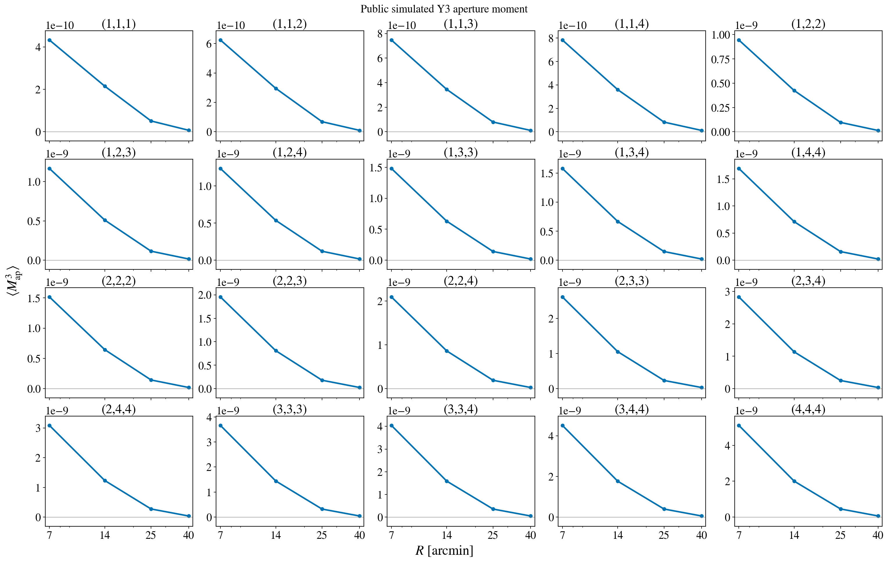
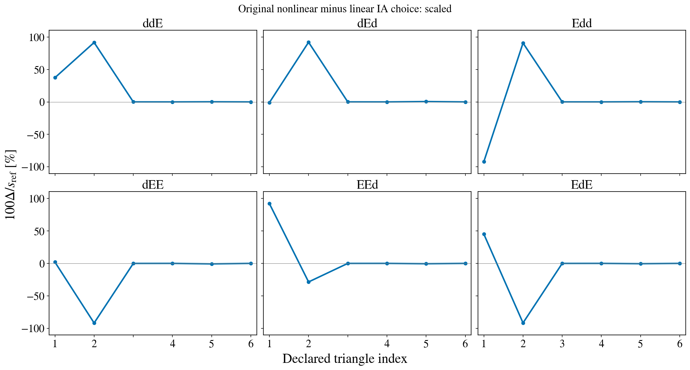
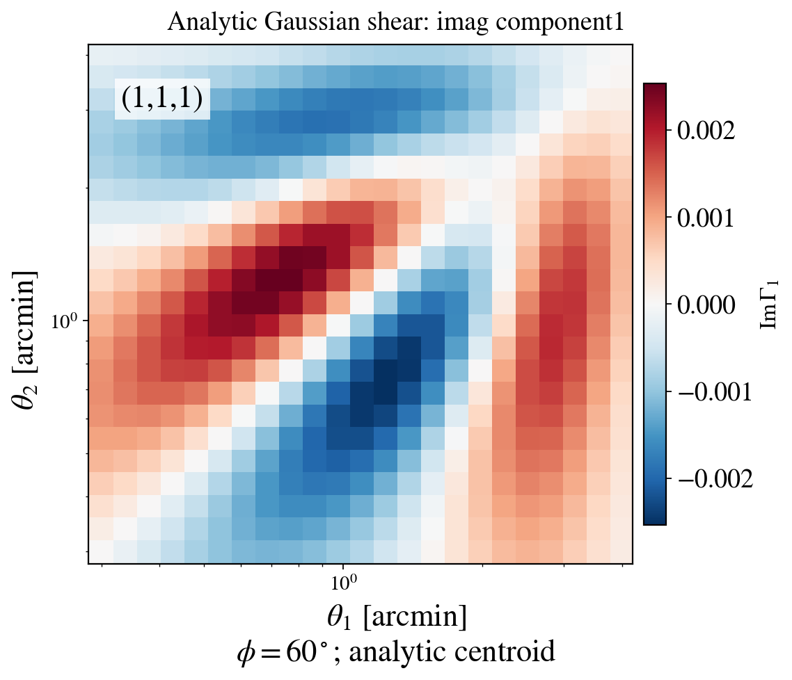
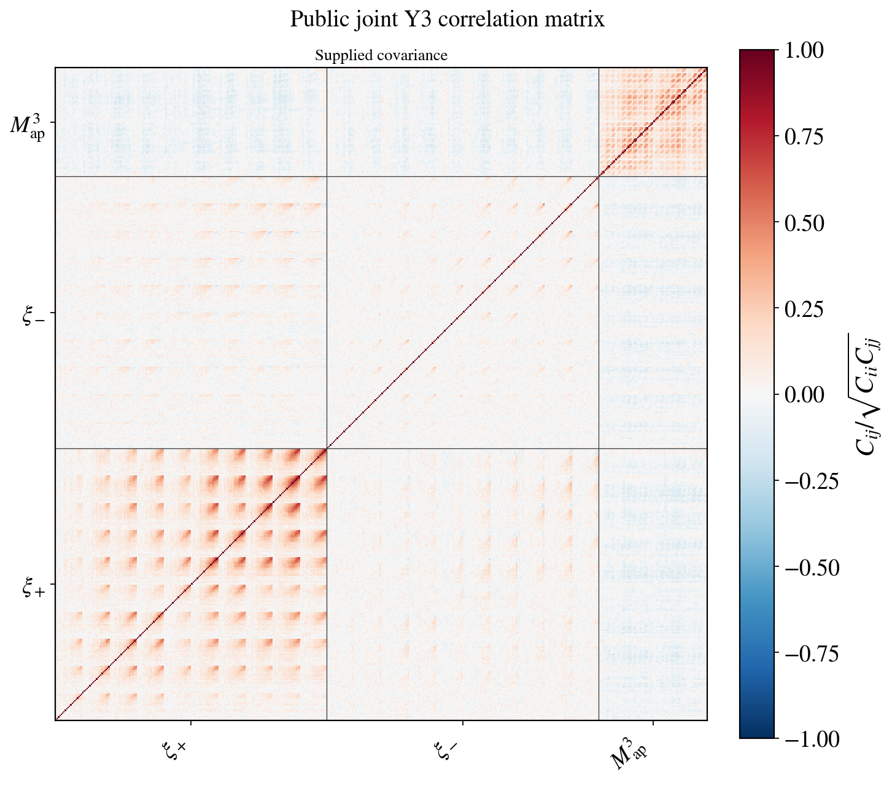

# Reading three-point shear figures

## Contents

1. [Loading the plotting functions](#loading)
2. [What is on the axes?](#axes)
3. [Comparing a prediction with a reference](#comparisons)
4. [Aperture moments and signed IA contributions](#apertures)
5. [Natural components as maps or slices](#natural)
6. [Covariance blocks and parameter errors](#covariance)
7. [Style, errors, and reproducible figure files](#style)
8. [Relationship to Rafael's figures and original code](#sources)

<a name="loading"></a>

## 1. Loading the plotting functions

These functions display arrays that a calculation has already produced. They
neither run a cosmological model nor change its angular bins, source ordering,
intrinsic-alignment prescription, or covariance. This separation matters when
comparing the C implementation with its original libraries: interpolation,
sorting, or a change of shear projection inside a plotting function could hide
the discrepancy that the figure is meant to explain.

**Step :one:**: load the shared plotting package. Python names
cannot begin with a digit, so load the requested `3pcf` directory with:

```python
import importlib

threepoint_plots = importlib.import_module("cosmolike_notebook_utils.3pcf")
```

Add the `cosmolike_core` directory to the Python import path through the project
notebook setup, as for the existing data-vector and covariance plots. The
functions use NumPy and Matplotlib only. They do not import the compiled
CosmoLike interface, CAMB, or either upstream three-point package. They do not
modify the supplied arrays or write files. Set `show=None` to receive the figure
and axes; save the returned figure explicitly in the notebook or script.

For the physical definitions and the distinction between estimators, read the
[three-point calculation guide](../../cosmolike/3pcf/README.md). The
[numerical guide](../../cosmolike/3pcf/NUMERICS.md) explains the preparation and
integration grids, and the [covariance guide](../../cosmolike/3pcf/COVARIANCE.md)
describes the physical contributions to a joint covariance.

<a name="axes"></a>

## 2. What is on the axes?

An aperture mass is a weighted average of the projected density over a circle.
Its filter has positive and negative regions whose integral is zero. Its third
moment, written $`\langle M_{\rm ap}^3\rangle`$, is sensitive to departures from a
Gaussian density field. For three source populations one can average the
product of three aperture masses, each formed from one population. A panel
labeled `(1,3,4)` identifies those populations. It does not denote three angular
bins. The `plot_Map3` function uses the same radius for the three filters and
places that common radius, in arcminutes, on the horizontal axis. Unequal-radius
measurements require a separately specified slice and can use
`plot_ia_components` with an explicit coordinate label.

The natural shear correlations $`\Gamma^{(0)},\ldots,\Gamma^{(3)}`$ are complex
three-point functions. Their four definitions differ in which shear factor is
complex conjugated. Their phases also depend on the directions used to project
the shear at each vertex. A centroid projection and an x projection are
different arrays, even for the same triangle. The plotting functions therefore
require a projection label and never rotate the supplied components. Real and
imaginary parts remain signed. A vanishing imaginary part can follow from
symmetry; it is not evidence that the measurement was excluded.

Tomographic triplets are supplied as zero-based integer arrays. The figures
print one-based labels while retaining their order. With intrinsic alignment,
exchanging only two source labels need not leave a prediction unchanged. Sort
neither the triplets nor the two side-length axes merely to make two panels
look alike. Establish the simultaneous leg, source, and projection mapping in
the calculation before comparing their arrays.

<a name="comparisons"></a>

## 3. Comparing a prediction with a reference

Let $`f`$ denote a displayed prediction and $`r`$ its reference at the same array
entry. Passing a reference enables one of four comparison definitions:

| `residual` | Displayed value | Interpretation |
|---|---|---|
| `"percent"` | $`100(f-r)/r`$ | Pointwise change in percent; the default for Map3 and IA panels. |
| `"sigma"` | $`(f-r)/\sigma`$ | Difference in units of a supplied positive diagonal standard deviation. |
| `"scaled"` | $`100(f-r)/s_{\rm ref}`$ | Signed difference divided by one fixed positive scale per panel. |
| `"absolute"` | $`f-r`$ | Signed difference in the original units. |

The factor of 100 is part of the percent and scaled definitions. These figures
never silently display a fractional change as a percent. All compared
coordinate grids must agree exactly: the plot does not interpolate one model
onto the other. A percent difference is undefined where the reference is
exactly zero. Such points are masked, with a diagnostic stating their number.
The map version draws them grey. A small nonzero reference is retained, even
if it produces a large ratio. Use an absolute difference to understand that
region, rather than clipping the ratio or imposing a denominator floor.

The scaled mode avoids a pointwise division near a zero crossing. By default,
$`s_{\rm ref}=\max_x |r(x)|`$ within each line panel. An entirely zero reference
has no such scale; provide a positive `reference_scale` in the same units, or
choose absolute mode. Gamma maps take one scale per triplet, over both side
axes. The scalar division does not remove the sign of the difference.

The sigma mode uses the supplied errors exactly. A line whose residual stays
below one sigma at every entry need not be negligible for a joint likelihood:
the covariance correlates those entries, and the parameter derivatives select
particular combinations of them. Likewise, smaller covariance diagonals do
not by themselves prove a larger Fisher figure of merit.

<a name="apertures"></a>

## 4. Aperture moments and signed IA contributions

`plot_Map3` takes a list of `(radius, values)` pairs. Each value array has shape
`[ntriplet, nradius]`; every curve uses the same coordinate grid. A reference is
one additional pair. The following example assumes that a calculation has
already supplied `radii_arcmin`, `map3`, `reference`, and `triplets`.

**Step :two:**: pass those arrays with their physical labels.

```python
figure, axes = threepoint_plots.plot_Map3(
    map3=[(radii_arcmin, map3)],
    map3_ref=(radii_arcmin, reference),
    triplets=triplets,
    residual="percent",
    legend=["C calculation"],
    marker=["o"],
    show=None,
)
```

Omit `map3_ref` to display the actual moment. `rescale=1` then multiplies each
panel by an annotated power of ten so that populations with different signal
amplitudes remain readable. This changes the display scale only; it is not a
normalization by a fitted prediction. `data=(radii_arcmin, observed)` and a
matching `sigma` add data error bars to an absolute-value plot. Error bars and
model curves both contribute to the automatic vertical range. An optional
Boolean `excluded[ntriplet]` explicitly marks omitted panels. A zero array is
otherwise drawn as a zero signal.

`plot_ia_components` accepts the same list-of-pairs structure, with shape
`[ncomponent, ncoordinate]`. The caller supplies `component_labels`,
`coordinate_label`, and `quantity_label`, including units. The function does
not infer what constitutes a component or construct their sum. An operator
decomposition, such as contributions involving $`C_1`$, $`C_2`$, $`C_{1\delta}`$, or
$`C_t`$, differs from a decomposition into ordered density/shear fields. If a
coefficient appears in several products, its separately evaluated response
need not be an additive component of the total. Supply actual components or
label the arrays as responses.

The plotting function also never changes a component's sign for presentation.
If a publication displays $`-C_t`$ rather than $`C_t`$, calculate that explicitly
before plotting and put the minus sign in the panel label. This prevents a
visual convention from being mistaken for a physical sign prediction.

The first example below displays the 80 entries of the public simulated Y3
Map3 input: 20 source triplets and four equal aperture radii. Each panel has
its own amplitude scale, so compare its axis as well as the curve height.
The second uses six saved original fastnc kernel samples, with explicit
density (`d`) and intrinsic E-mode (`E`) field positions. It compares two
physical power-input choices, not two numerical accuracies or two codes.





<a name="natural"></a>

## 5. Natural components as maps or slices

`plot_Gamma` displays a fixed-opening-angle map over two side lengths. Supply
`gamma=(theta1_arcmin, theta2_arcmin, values)`, where `values` is complex with
shape `[ntriplet, 4, ntheta1, ntheta2]`. The axes may have different lengths.
The function selects `component=0,1,2,3` and `part="real"` or `"imag"`. It
requires `opening_angle_deg`, `projection`, and the ordered `triplets`. The
vertical map axis is the second side; no source or shear-component permutation
accompanies the transpose needed by Matplotlib's image layout.

```python
figure, axes = threepoint_plots.plot_Gamma(
    gamma=(theta1_arcmin, theta2_arcmin, gamma_centroid),
    gamma_ref=(theta1_arcmin, theta2_arcmin, gamma_without_ia),
    triplets=triplets,
    opening_angle_deg=60,
    projection="centroid",
    component=0,
    part="real",
    residual="percent",
    show=None,
)
```

All panels share a diverging color scale that retains both signs and every
finite displayed value. Optional `limits=(low, high)` must contain the complete
displayed range. When comparing separate figures, choose common limits from
both arrays; equal colors then have the same meaning. Masked ratios are grey,
not zero-valued white pixels.

`plot_natural_components` displays all four complex components along one
declared coordinate slice. Its input curves contain complex `[4,ncoordinate]`
arrays. The first row shows their real parts; the second shows their imaginary
parts. Supply `coordinate_label`, `slice_label`, and `projection` to state what
is held fixed. The default reference comparison is an absolute difference,
because imaginary components frequently pass through zero. If needed, sigma
arrays have shape `[8,ncoordinate]`, ordered Re0–Re3 followed by Im0–Im3.

`plot_code_comparison` is a short route to the same signed line panels for
`reference[nseries,ncoordinate]` and `ported[nseries,ncoordinate]`. It defaults
to a scaled difference, rather than manufacturing a relative error at zeros.
It does not certify the reference's provenance or calculate a convergence
tolerance. The comparison driver must record the upstream commit, input
arrays, physical choices, and numerical settings along with its full-array
error assessment. A convenient slice can illustrate that assessment but cannot
replace it.

This map uses an exact polynomial-Gaussian shear reference, with no DES
cosmology or source populations. Its single label denotes one hypothetical
source field. The imaginary component changes sign with triangle shape;
replacing it by an absolute value would discard information. The supplied
calculation and scale are recorded in the [figure manifest](examples/manifest.json).



<a name="covariance"></a>

## 6. Covariance blocks and parameter errors

The package re-exports the existing shared covariance plotting functions
without changing their behavior:

| Function | Inputs and meaning |
|---|---|
| `plot_correlation` | A covariance and optional reference; uses each matrix's own diagonal to form $`C_{ij}/\sqrt{C_{ii}C_{jj}}`$. |
| `plot_covariance_components` | A total and named signed component matrices; displays diagonal-normalized contributions or explicitly masked element ratios. |
| `plot_covariance_diagonal` | Covariance standard deviations by coordinate and panel, or their percent changes against a reference. |

For a joint data vector ordered as $`(\xi_+,\xi_-,M_{\rm ap}^3)`$, pass the
actual contiguous `block_sizes` and `block_labels`. A cross block $`C_{23}`$
correlates a two-point measurement with a three-point measurement. Deleting it
changes the statistical model; an empty-looking region of a color map is not
permission to delete it. A matrix split into estimator blocks is also not a
decomposition into Gaussian, connected, and super-sample covariance. Label
these two different decompositions accordingly.

The inherited component plot can mask element ratios where the total nearly
cancels, using its explicit `denominator_floor` argument. That existing display
rule differs from the new line panels' exact-zero-only masking. Neither rule
changes the matrix. Read the
[shared covariance plotting implementation](../plot_covariances.py) for the
normalizations, matrix-triangle convention, and return shapes.

`plot_parameter_errors` consumes already calculated positive marginalized
standard deviations. Pass `names`, a list of arrays `errors`, and optionally
`errors_ref`. With a reference it displays $`\sigma(p)/\sigma_{\rm ref}(p)`$ and
a horizontal line at one. This ratio is dimensionless and is **not** a percent
change. The function performs no matrix inversion, prior addition, compression,
or treatment of unconstrained parameter directions. Those scientific choices
belong to the Fisher calculation. Without a reference, use parameters in common
units or explicitly normalized errors; unrelated parameter units should not be
compared on one unexplained vertical axis.

The example correlation matrix below comes from the supplied public Y3
sample covariance. The labels preserve its 200 xi-plus, 200 xi-minus, and
80 Map3 entries. The cross blocks contain correlations between distinct
estimators; this picture alone does not establish the accuracy of an analytic
covariance or the numerical stability of its inverse.



<a name="style"></a>

## 7. Style, errors, and reproducible figure files

The new line plots share the familiar `legendloc`, `legendfontsize`,
`xaxislabelsize`, `yaxislabelsize`, `xaxisticklabelsize`, `yaxisticklabelsize`,
`bintextpos`, `bintextsize`, and `markersize` controls. Curve style sequences
cycle when shorter than the curve list. Supplying `param` gives one sweep value
per curve and uses the same normalization for curve colors and their colorbar.
`colorbar=0` suppresses that bar; `colorbarshrink` controls its height. Avoid
legends with dozens of parameter values when a labeled colorbar explains them.
For line panels, `bintextpos=None` places component labels above the axes,
keeping them clear of extrema or zero crossings. A short logarithmic aperture
bank labels its actual supplied radii rather than crowding logarithmic minor
tick labels into each panel.

Residual and rescaled line panels share a vertical range within each row and
omit duplicated interior tick labels. Automatic ranges include zero and add
ten-percent padding. Ordinary absolute-value panels retain their own amplitude
ranges. `ylim` is an explicit display choice in the final displayed units.
Set STIX fonts and figure resolution in the notebook or rendering script;
the functions do not mutate global Matplotlib style.

The new functions follow the data-vector plotting error convention: malformed
input prints a named `Bad Input` diagnostic and returns `0`. Valid calls return
`(figure, axes)` when `show=None`; otherwise they display the figure and return
`None`. The inherited covariance functions retain their existing `ValueError`
contract. A returned plot is a presentation of supplied arrays, not a check of
their physical units, source-kernel normalization, positive definiteness, or
agreement with a published inference.

**Step :three:**: prepare the thread settings. Start in an activated `Cocoa/`
directory, after `source start_cocoa.sh`, and enter
`external_modules/code/cosmolike_core/`.

On Linux:

```bash
export OMP_NUM_THREADS=1
export OMP_THREAD_LIMIT=4
export OMP_PROC_BIND=close
export OMP_PLACES=cores
export OMP_DYNAMIC=FALSE
export OPENBLAS_NUM_THREADS=1
export MKL_NUM_THREADS=1
export VECLIB_MAXIMUM_THREADS=1
export BLIS_NUM_THREADS=1
export NUMEXPR_NUM_THREADS=1
```

On macOS:

```bash
export OMP_NUM_THREADS=1
export OMP_THREAD_LIMIT=4
export OMP_PROC_BIND=disabled
export OMP_PLACES=cores
export OMP_DYNAMIC=FALSE
export OPENBLAS_NUM_THREADS=1
export MKL_NUM_THREADS=1
export VECLIB_MAXIMUM_THREADS=1
export BLIS_NUM_THREADS=1
export NUMEXPR_NUM_THREADS=1
```

**Step :four:**: run the array checks and render the figures from that core
directory. Supply the actual project and output paths to the renderer.

```bash
python -m pytest --import-mode=importlib \
  cosmolike_notebook_utils/3pcf/tests/test_plots.py

python cosmolike_notebook_utils/3pcf/tests/render_examples.py \
  --project-dir /absolute/path/to/Cocoa/projects/des_3pcf \
  --output-dir /absolute/path/to/figure_output
```

The renderer uses public Y3 input files with checked Git blob hashes, a saved
reference generated by the pinned fastnc source, and an analytic Gaussian shear
reference. Its manifest identifies the source of each figure. The public Y3
Map3 array is a supplied simulated data vector, not a new C prediction or an
observed-sky measurement. Analytic shear examples have no DES source model.
The small illustrative parameter-error display tests the plot convention and
is not a Fisher forecast. BLAS remains restricted to one thread; array plotting
does not request OpenMP workers or run a compiled scientific calculation.

<a name="sources"></a>

## 8. Relationship to Rafael's figures and original code

The array arrangements follow the scientific questions illustrated in Rafael
Gomes and collaborators' papers. In
[the joint two-/three-point analysis](https://arxiv.org/abs/2503.03964), Map3
panels and the $`C_{22}`$, $`C_{33}`$, and $`C_{23}`$ blocks describe different parts
of one likelihood. In
[the TATT three-point study](https://arxiv.org/abs/2601.09133), the first two
figures show real natural-component maps at a fixed opening angle; later
figures separate alignment responses, signed operator contributions, and
ordered field contributions. Our helpers provide those array layouts and
comparison definitions. They do not infer the paper's scale cuts, fit its
parameters, recover unpublished input arrays, or reproduce its posterior.

The numerical calculation credits Sunao Sugiyama's
[fastnc TATT branch](https://github.com/git-sunao/fastnc/tree/tatt) and Rafael
Gomes's [3pcf_integrator](https://github.com/rchgomes/3pcf_integrator) and
[desy6-3pcf](https://github.com/rchgomes/desy6-3pcf). The plotting conventions
also follow this repository's existing
[data-vector](../plot_datavectors.py) and
[covariance](../plot_covariances.py) functions. The new helpers implement no
upstream scientific kernel; the original-code comparison belongs to the
[DES three-point project](../../../../../projects/des_3pcf/README.md), with its
pinned source and input records.
