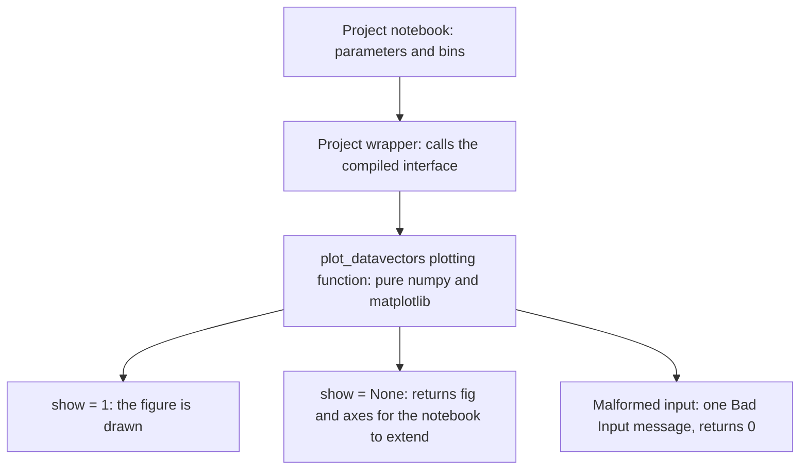
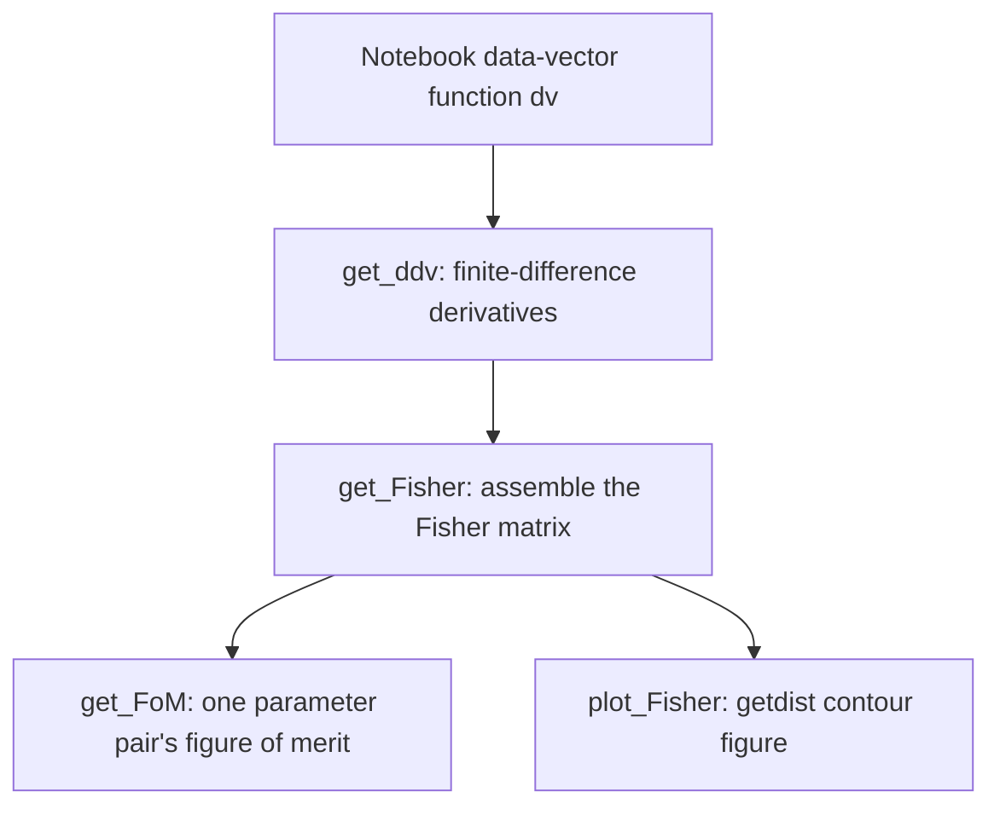

# Table of contents

1. [What this package provides](#overview)
2. [Using the package from a notebook](#usage)
3. [The modules](#modules)
4. [Design rules every module follows](#design)
5. [The plotting conventions](#plotting)
6. [CAMB input and Fisher forecasts](#fisher)
   1. [Choosing accuracy from a default Fisher base](#fisher-noise)
7. [Units and array conventions](#units)
8. [The covariance subpackage](#covariance)
9. [Three-point figures](#threepcf)
10. [Appendix](#appendix)
   1. [How do I plot a quantity for a new probe?](#new_probe)
   2. [Why do the Fisher helpers take my function as an argument?](#why_dv)
   3. [Why is one panel empty and marked "excluded"?](#excluded)
   4. [Where do fonts and figure styles belong?](#styles)
   5. [How do I check that a figure is right?](#check_figures)
   6. [The n(z) reconstruction study](#nz_study)

# What this package provides <a name="overview"></a>

Every Cosmolike project ships `EXAMPLE_EVALUATE*.ipynb` notebooks that
drive its compiled interface directly: they run CAMB, call
`set_cosmology` and the nuisance setters, and inspect data vectors,
spectra and covariances. The calculations and figures that do not
depend on one project live here, once. A private copy in each notebook
would drift, and every interface change would have to be repeated in
each project.

The package serves a reader who wants to inspect a project's
predictions interactively. Calculus, linear algebra, elementary
probability and some NumPy suffice: the
[data-vector guide](../cosmolike/README.md) explains the observables
and the C calculation that produces the quantities plotted here, and
the [covariance physics guide](../cosmolike/covariances/README.md)
explains the covariance components. A useful first path reads the
data-vector guide's overview and units, then
[the plotting conventions](#plotting) and [units](#units) here, and
then [the Fisher section](#fisher), which defines the forecast its
helpers compute before naming them.

# Using the package from a notebook <a name="usage"></a>

We assume Cocoa and one project (LSST Y1 below) are installed, users
have run `conda activate cocoa`, and Bash is open in `cocoa/Cocoa`.

**Step :one:**: activate Cocoa's environment and compile the project.

```bash
source start_cocoa.sh
unset IGNORE_COSMOLIKE_LSST_Y1_CODE
source ./projects/lsst_y1/scripts/compile_lsst_y1.sh
```

**Step :two:**: start Jupyter and open a project notebook.

```bash
jupyter lab --no-browser
```

**Step :three:**: inside the notebook, import the package.

```python
sys.path.insert(0, os.environ['ROOTDIR']
                + '/external_modules/code/cosmolike_core')
import cosmolike_notebook_utils as cnu
```

`import cosmolike_notebook_utils as cnu` binds the CAMB helper, the
galaxy/shear plotters and the Fisher tools. Three module groups are
deliberately not bound by that line and are imported explicitly where
they are used:

```python
from cosmolike_notebook_utils import plot_datavectors_cluster as pdc
from cosmolike_notebook_utils import covariance as cov
from cosmolike_notebook_utils import plot_covariances as pcov
```

The cluster plotters stay separate because only cluster projects need
them; the covariance modules stay separate because covariance
generation is optional at compilation and its notebooks follow their
[own guide](covariance/README.md).

How one data-vector figure is produced, from a notebook to the
screen. The return conventions in this diagram belong to the
`plot_datavectors` families; the other modules follow their own
contracts, listed with [the plotting conventions](#plotting):



# The modules <a name="modules"></a>

| Module | What it supplies |
| --- | --- |
| [camb_cosmology.py](camb_cosmology.py) | `get_camb_cosmology`: one CAMB run packaged into the tuple `set_cosmology` consumes, on the nested grids the likelihoods use. |
| [plot_datavectors.py](plot_datavectors.py) | Tomographic panel grids of the galaxy/shear data vectors: `plot_C_ss_tomo_limber`, `plot_xi`, `plot_C_gs_tomo_limber`, `plot_gammat_tomo_limber`, `plot_C_gg_tomo`, `plot_wtheta_tomo`, and the baryonic-feedback sweep `plot_baryon_suppression`. |
| [plot_datavectors_cluster.py](plot_datavectors_cluster.py) | The cluster observables: `plot_N_cluster` counts, cluster lensing (`plot_gammat_cluster_tomo`, `plot_sigma_cluster_tomo`, `plot_C_cs_tomo_limber`), cluster clustering and cluster x galaxy, in the same panel conventions. `plot_sigma_cluster_tomo` receives the already transformed localized cluster-lensing statistic (the data vector's Y operator applied to gamma_t, with calibration and selection factors); its last angular bin is a constructed zero, not a measured zero signal (the operator subtracts the outermost bin's estimate from itself), and is omitted from the curves; the [covariance guide](covariance/README.md#real_space_and_fourier_assembly) defines the transformation. |
| [plot_response.py](plot_response.py) | `plot_response_function`: how each data-vector entry responds to the matter power spectrum. It draws the arrays the notebook wrappers compute: local response curves (the entry's contribution per logarithmic wavenumber interval, divided by the fixed full entry) and the accumulated absolute fraction RF(k_max), normalized by the total over the finite response table so it rises from 0 to 1 for a nonzero entry. The optional peak division is display-only. |
| [fisher.py](fisher.py) | Finite-difference and derivkit derivatives of a supplied data-vector function (`get_ddv`, `get_ddv_dkit`), Fisher assembly (`get_Fisher`, `get_Fisher2`), `get_FoM`, Gaussian priors and getdist contour plots (`plot_Fisher`). |
| [plot_nz_reconstruction.py](plot_nz_reconstruction.py) | `plot_nz_four_reconstructions`: regenerate the manual study’s two-panel figure from saved compiled-reader samples and bin-area measurements; no cosmology calculation. |
| [plot_covariances.py](plot_covariances.py) | Covariance figures from supplied arrays: split correlation triangles, component maps and histograms, and standard deviations per angular or multipole bin. |
| [covariance/](covariance/README.md) | Preparation and assembly of Gaussian, super-sample and connected non-Gaussian covariance forecasts, with accuracy controls, eigenvalue diagnostics and independent test oracles. |
| [3pcf/](3pcf/README.md) | Three-point shear, aperture and joint covariance figures from supplied arrays, with the component conventions and interpretation of the paper comparisons. |

Each module's docstrings carry the complete argument lists, shapes and
units; `help(cnu.plot_xi)` in a notebook prints them.

# Design rules every module follows <a name="design"></a>

- **The package never imports a project's compiled interface**
  (`cosmolike_<project>_interface`). Each project compiles its own
  module, so importing one here would bind the package to whichever
  project a notebook loaded first. A function that needs cosmolike
  receives the notebook's callable as an argument instead: the `dv`
  and `ddv` parameters of the Fisher helpers, and the `interface`
  argument of the covariance assembly.
- **The plotting modules are pure numpy and matplotlib.** They never
  call CAMB or compiled code, so every project shares them unchanged
  and they run without a compiled interface.
- **Cluster code lives in files whose names end in `_cluster`**, as in
  the C core. The galaxy modules and this package's `__init__.py` do
  not import it; notebooks import it explicitly.
- **Project facts stay in the project**: fiducial values, bin layouts
  and the interface init sequence live in each project's notebooks and
  in `projects/<name>/interface/cosmolike_<name>_notebook_wrappers.py`,
  which binds them to the shared functions here.
- **Figures are evidence, not decoration.** A plotting function never
  modifies its input arrays; what it draws is a stated per-family
  display statistic of them (see
  [the plotting conventions](#plotting)). An undefined ratio point is
  left undefined rather than repaired (the docstrings state each
  family's zero-reference behavior), and no covariance is repaired to
  look positive.

# The plotting conventions <a name="plotting"></a>

The `plot_datavectors` family shares one behavior, so figures of
different probes look alike and notebooks can swap them:

- **One panel per tomographic bin or bin pair.** Cosmic shear is a
  lower triangle, galaxy-galaxy lensing a source-row by lens-column
  grid, clustering one row of auto panels. The panel label counts bins
  from 1; the arrays index them from 0, so the panel labeled (1,2)
  draws the slice `[:, 0, 1]`.
- **First arguments:** the list of curves (each entry what the project
  wrapper returns), then the optional reference, then `param` and
  `colorbarlabel` for a parameter sweep colored by one colorbar.
- **Without a reference** each panel shows the probe's display
  statistic (the table below) with its own y-range; **with a
  reference** every family shows value/reference - 1 on one shared
  linear band, with the panels glued edge to edge.
- **`rescale = 1`** glues the absolute panels instead: each panel is
  multiplied by its own power of ten, annotated inside as alpha.
- **`show = 1` draws the figure; `show = None` returns `(fig, axes)`**
  for the notebook to extend. Malformed input prints one `Bad Input`
  message naming the problem and returns 0 instead of raising.
- **An extra bin index becomes curves inside a panel, not more
  panels**: the richness bins of the cluster blocks are line styles,
  with their own legend when more than one is drawn.
- **The functions do not save files and do not set fonts or styles**;
  see the [styles FAQ](#styles).

The display statistic differs by family; the input arrays are never
changed:

| Function | Without a reference it draws | y axis |
| --- | --- | --- |
| `plot_C_ss_tomo_limber` | ell(ell+1) C_ell / 2 pi | log |
| `plot_C_gs_tomo_limber` | the absolute value \|C_ell\| (a sign crossing, e.g. from magnification, shows as a dip) | log |
| `plot_C_gg_tomo` | C_ell itself | log; linear with `forcelinearyscale` |
| `plot_xi` | theta xi 10^4, keeping the sign | linear |
| `plot_gammat_tomo_limber`, `plot_wtheta_tomo` | the absolute value | log |

These conventions describe the `plot_datavectors` families. The other
modules state their own contracts in their docstrings:
`plot_response_function` opens a pyplot figure and returns `None` in
every case, the covariance plotters of
[plot_covariances.py](plot_covariances.py) raise `ValueError` on
invalid input instead of printing `Bad Input`, and
[plot_nz_reconstruction.py](plot_nz_reconstruction.py) saves a PNG to
the path it is given.

# CAMB input and Fisher forecasts <a name="fisher"></a>

`get_camb_cosmology(...)` runs CAMB once and returns the tuple that
`set_cosmology` consumes: log10 wavenumber grids, the linear and
nonlinear ln-power tables, distances and the growth table, on the same
nested grids the likelihoods build. Its `AccuracyBoost` knob follows
the likelihoods' split: the CAMB side receives the factor
`1 + (AccuracyBoost - 1)/3`, and the grid densities scale with the
boost. The growth factor is normalized at the end of the 2D redshift
grid, exactly as in the likelihoods. One grid density grows with the
CAMB-side boost here and with the cosmolike accuracy boost in the
likelihoods: the two grids coincide at boost 1, so a shared
normalization alone does not make boosted notebook and likelihood
spectra numerically identical; check agreement at the settings you
use.

**What a Fisher matrix measures.** Near the chosen fiducial
parameters $`p_0`$, write the predicted data vector as
$`\mu(p_0+\delta p)\simeq\mu_0+D\,\delta p`$: column $`i`$ of $`D`$ is
the derivative of the prediction with respect to parameter $`p_i`$.
With a fixed Gaussian data covariance $`C`$, the quadratic change of
$`-2\ln L`$ is $`\delta p^{\mathsf T}F\,\delta p`$ with

```math
F = D^{\mathsf T} C^{-1} D .
```

A parameter change matters when it is large compared with the
correlated measurement uncertainty. $`F`$ is a local statement about
the information in the mean at $`p_0`$, not a global posterior. An
independent Gaussian prior of width $`\sigma`$ on parameter $`i`$ adds
$`1/\sigma^2`$ to $`F_{ii}`$. Marginalized errors invert the full
matrix first and then select parameters:
$`\sqrt{(F^{-1})_{ii}}`$ marginalizes over the others, while
$`1/\sqrt{F_{ii}}`$ holds them fixed. `get_FoM` returns
$`1/\sqrt{\det C_{ij}}`$ with $`C_{ij}`$ the marginalized 2x2 block of
the pair $`(i, j)`$; a block that is not positive definite (any
eigenvalue $`\le 0`$) bounds no error ellipse, so `get_FoM` raises a
`ValueError` instead of returning a number for it
([fisher.py](fisher.py)'s docstrings state this contract).

A two-measurement example shows why more curves alone are not more
information. Measure one parameter $`p`$ twice, each with variance
$`\sigma^2`$ and correlation coefficient $`\rho`$, so
$`D=(1,1)^{\mathsf T}`$. Then

```math
F=\frac{2}{\sigma^2(1+\rho)},\qquad
\sigma_p^2=\frac{1}{F}=\frac{\sigma^2(1+\rho)}{2}.
```

Independent measurements ($`\rho=0`$) halve the variance; as $`\rho`$
approaches 1 the pair approaches two copies of the same information.
This is an analytic illustration, not a survey result: whether finer
tomographic bins help is decided jointly by the derivatives, the
covariance and the nuisance degeneracies, not by the number of
plotted curves.



The Fisher helpers build forecasts from any function that maps a
parameter vector to a data vector. Here `my_datavector` is the
notebook's own wrapper around the compiled interface, called as
`dv(param=<1D array>, AccuracyBoost=<float>)` and returning the
$`n_d`$-entry theory vector; `fiducial_parameters` holds the $`n_p`$
fiducial values, and `masked_inverse_cov` is the
$`(n_d, n_d)`$ inverse covariance, in the same entry ordering as the
data vector:

```python
def derivative(index, h, CV, AccuracyBoost):
    return cnu.get_ddv(dv=my_datavector, index=index, h=h,
                       CV=CV, AccuracyBoost=AccuracyBoost)

fisher = cnu.get_Fisher(ddv=derivative, CV=fiducial_parameters,
                        invcov=masked_inverse_cov, h=0.02)
print(cnu.get_FoM(i=0, j=1, F=fisher))
```

`get_Fisher` calls the derivative function once per parameter and
glues the returned vectors as the columns of $`D`$; `CV` is always the
fiducial parameter vector, never a covariance. `get_ddv` uses a
five-point finite-difference stencil; `get_ddv_dkit`
uses the derivkit package; `get_Fisher2` combines both steps.
`plot_Fisher` draws getdist contours from one or two Fisher matrices.
The derivative step sizes and the figure-of-merit convention are
documented in [fisher.py](fisher.py)'s docstrings, including the
limits of each shortcut.

## Choosing Fisher accuracy from a default-accuracy base <a name="fisher-noise"></a>

A Fisher calculation can report artificially small errors when numerical
noise contaminates its derivatives. The derivative divides a difference of
nearby predictions by a small parameter step. Squaring that derivative in
$`F=D^T C^{-1}D+F_{\rm prior}`$ turns some of the noise into positive
information. Agreement of the fiducial mean alone does not test this effect.

The expensive part of the screening calculation runs once at **default
accuracy**: build the full derivative matrix and Fisher matrix, including
the configured priors. `get_fom_noise_weights`, `get_stencil_noise` and `predict_fom_noise` in
[fisher.py](fisher.py) compute the marginalized dark-energy
weights, the per-column stencil noise and the predicted FoM shift. They
implement the estimate derived in the derivative-accuracy section of the
Fisher machinery note in the LSST Y1 × DESI project
(`projects/lssty1xdesi/notes/fisher_machinery/`), with the same meaning of each quantity.

Let $`S=F^{-1}`$ be the parameter covariance and $`S_w`$ its marginalized
$`(w_0,w_a)`$ block. For parameter $`p_j`$, the default-accuracy calculation
supplies a weight

```math
R_j^2\sigma_j^2=S_{j,w}S_w^{-1}S_{w,j},\qquad \sigma_j^2=S_{jj}.
```

The weight measures how uncertainty in that parameter affects the dark-energy
ellipse. A nuisance parameter can matter even though it is neither $`w_0`$
nor $`w_a`$; marginalization must keep its covariance with the pair.
At each candidate accuracy, measure only the columns that these weights
and the baseline noise audit select; rebuilding the entire derivative base
at every setting would lose the method's cost advantage.

Five equally spaced predictions give the fourth difference
$`\Delta^4m=m(-2h)-4m(-h)+6m(0)-4m(h)+m(2h)`$. If evaluation errors have
approximately independent, equal-size fluctuations along this stencil,

```math
\widehat\sigma_{\rm eval,j}^2=
\frac{\Delta^4m_j^T C^{-1}\Delta^4m_j}{70},\qquad
a_j=\frac{130}{144}\frac{\widehat\sigma_{\rm eval,j}^2}{h_j^2},\qquad
\delta\ln{\rm FoM}\simeq\frac12\sum_j R_j^2a_j\sigma_j^2.
```

Here $`h_j`$ is an absolute step in the units of parameter $`p_j`$.
`get_stencil_noise` accepts the relative-step convention documented in its
docstring. An adapter with absolute steps can supply parameter offsets
about zero; it must not accidentally rescale the step or reverse it at a
negative fiducial value.
The factors 70 and 130 are sums of squared stencil coefficients. They
describe independent numerical errors, not a new physical covariance term.
For large predicted shifts, the shared calculation also evaluates the exact
ratio $`{\rm FoM}(F+\operatorname{diag}a)/{\rm FoM}(F)`$ instead of truncating
the matrix calculation at first order.

A full default-accuracy run can save the five vectors at both $`h`$ and
$`h/2`$ for every parameter. Its baseline noise audit therefore needs no
additional model evaluations. A candidate examining $`k`$ columns at one
spacing needs $`1+4k`$ distinct evaluations, including a shared center.
The report lists omitted columns and their measured baseline contribution.
A small baseline contribution is not a bound on how that column's noise
changes at another accuracy.

This procedure screens settings; it does not certify convergence. A smooth
fourth derivative also enters $`\Delta^4m`$, while an odd numerical error can
cancel from it and still bias the first derivative. Correlations between
nearby evaluations violate the independent-noise estimate. The final check
therefore compares full Fisher matrices at finer settings and at both step
sizes, with the covariance, priors, physical model and rows held fixed.
Separate range, angular-truncation and source-table checks remain
necessary. Report the actual FoMs from those full derivatives, never an
estimated corrected scientific FoM obtained by subtracting the noise model.

A concrete diagnostic is a numerical cusp, $`m(p)=v|p-p_0|`$. A centered
five-point fourth difference at $`p_0`$ is $`-4hv`$. Its inferred vector
noise amplitude therefore scales as $`h`$, while the corresponding false
information estimate can remain constant when the step is halved. That
behavior is not independent random noise. Smooth fourth-derivative
contamination instead scales as $`h^4`$; ideal independent evaluation noise
has roughly constant amplitude. Compare one-sided slopes, shifted stencil
centers and more than two step sizes when a table-cell crossing or source
boundary could be responsible. Shared stencil samples mean these scaling
checks are diagnostics, not independent statistical measurements.


# Units and array conventions <a name="units"></a>

| Quantity | Convention |
| --- | --- |
| Angle | The plotters take and display theta in arcminutes; the C core integrates in radians, and the project wrappers convert. |
| Multipole | The plotters draw whatever multipole values the wrapper supplies, including noninteger band centers; the C core's internal harmonic sums run over integer ell. The shear plotter draws ell(ell+1) C_ell / 2 pi; the galaxy-galaxy lensing and clustering plotters draw C_ell itself. |
| Wavenumber | `get_camb_cosmology` works in CAMB's 1/Mpc while filling its tables and returns log10 k in h/Mpc, as the interface tuple requires; `plot_baryon_suppression` takes log10 k in 1/Mpc. If k_phys is the numerical value in 1/Mpc, then k_h = k_phys/h and P_h = h^3 P_phys, so the product k^3 P is unchanged. |
| Power tables | Natural logarithm of P in (Mpc/h)^3, as the interface expects. |
| Distance | `get_camb_cosmology` returns comoving distance in Mpc/h. |
| Bin index | Function arguments count bins from 0, as the arrays do; panel labels and legends count from 1. |
| Data-vector order | Panel-major: each probe's tomographic rows hold their angular bins or multipoles contiguously, matching the project's data files. |

The [data-vector guide's unit appendix](../cosmolike/README.md#units)
covers the core's internal c/H0 conventions, which matter when calling
the compiled interface directly.

# The covariance subpackage <a name="covariance"></a>

[covariance/](covariance/README.md) prepares survey inputs and
assembles complete Gaussian + SSC + cNG forecasts in real and Fourier
space, through the same C kernels the production command line uses.
Its guide documents the array conventions, the one `accuracy_boost`
knob and the independent `integration_accuracy` ladder, the eigenvalue
diagnostics, and the independent oracles that test the C components.
Covariance generation must be enabled at compilation
(`IGNORE_COSMOLIKE_<PROJECT>_COVARIANCE`); reading a supplied
likelihood covariance never requires it.

[plot_covariances.py](plot_covariances.py) draws the resulting
matrices: split correlation triangles comparing two matrices, G/SSC/cNG
component maps and histograms, and per-bin standard deviations. It
receives arrays only; every mask it applies is display-only.

# Three-point figures <a name="threepcf"></a>

The [three-point plotting guide](3pcf/README.md) connects natural shear
components, aperture moments and covariance blocks to the observables in
the papers by Gomes and collaborators. The plotting functions receive
calculated arrays; they do not import a compiled project interface or
choose a physical model. The [three-point physics guide](../cosmolike/3pcf/README.md)
defines the shear rotations, source labels and finite-triangle estimator.

**Step :one:**: import the plotting module in a configured Cocoa notebook.

```python
import importlib

threepcf_plots = importlib.import_module("cosmolike_notebook_utils.3pcf")
```

The directory name starts with a digit, which Python cannot place directly
after `import`. Passing the module name as a string preserves the requested
folder name. This explicit import leaves the package's ordinary notebook
imports unchanged. Examples and input shapes are in the linked guide.

# Appendix <a name="appendix"></a>

## How do I plot a quantity for a new probe? <a name="new_probe"></a>

Copy the conventions of the existing family rather than inventing a
layout: one function per probe and space, named `plot_<quantity>`; the
argument order, shared option set and return cases of
[the plotting conventions](#plotting); the glued-panel helpers of
`plot_datavectors.py`. Then render every mode (absolute, rescaled,
ratio, with data points, with an excluded panel) and look at the
images before trusting the function: overlapping tick labels and a
legend covering a curve are found by looking, not by tests.

## Why do the Fisher helpers take my function as an argument? <a name="why_dv"></a>

Because the package never imports a compiled interface, the notebook
owns the binding between cosmolike and the parameter vector. Passing
`dv` explicitly keeps that ownership visible, lets two projects use
the same helpers in one session, and avoids replacing module state at
run time, which these repositories prohibit.

## Why is one panel empty and marked "excluded"? <a name="excluded"></a>

A (lens, source) pair dropped by the project's `init_ggl_exclude`
arrives as an identically zero array. Drawing zeros on a log axis
would fail, and silently skipping the panel would hide the exclusion,
so the panel stays in the grid with an "excluded" placeholder.

## Where do fonts and figure styles belong? <a name="styles"></a>

In the notebook. The plotting functions accept explicit size options
(axis labels, tick labels, legends, bin labels) but never set global
matplotlib state, so a notebook's rcParams choices (for example
Cocoa's STIX/retina setup) apply to every figure uniformly.

## How do I check that a figure is right? <a name="check_figures"></a>

Plot a quantity against its own reference first: the drawn ratio is
value/reference - 1, so a self-reference must sit at exactly zero
wherever the reference is nonzero. A zero reference is not repaired:
the galaxy plotters divide directly, so a nonzero value over a zero
reference runs to infinity (off the panel) and 0/0 gives NaN, which
matplotlib does not draw; the cluster plotters set zero references to
NaN before dividing. The `ylim` band of the ratio mode is
typed around 1 and drawn as ylim - 1, so it brackets that zero line.
For covariances, `covariance.diagnostics.covariance_modes` reports the
correlation eigenvalues of the matrix a figure summarizes; a plot can
hide a negative mode that the eigenvalues expose. The project test
suites under `projects/<name>/tests/` remain the quantitative checks;
figures complement them.

## The n(z) reconstruction study <a name="nz_study"></a>

Optional studies explore how numerical settings and modeling choices
affect predictions. These comparisons can be expensive, so every survey
runs them separately from its routine tests, through the stubs in its
`tests/studies/` folder. This guide is the shared explanation of the
n(z) reconstruction study; each survey's `tests/studies/README.md`
records only that survey's measured distances, areas, deviations and
saved records.

The study compares the original cubic with fixed 3-, 5- and 7-point
Akima reconstructions of the same redshift histograms, and separately
compares the original reconstruction at default and refined accuracy.

### Four reconstructions of the same histogram

`photoz_histogram_akima: 0` is the unchanged default: a curve through
the original bin centres, followed by a natural cubic on a uniform
lookup grid. With `photoz_histogram_akima: 1`, choose
`photoz_histogram_akima_factor: 3`, `5` or `7`. These odd factors
retain the centre of each uniform input bin. Irregular input cells are
remapped with overlap-weighted cell averages. Akima then smooths the
transitions between those prepared cells.

The **preparation factor is fixed independently of accuracy**. Raising
the lookup accuracy subdivides the same Akima polynomial algebraically;
it does not refit or sharpen the curve. Both reconstructions use
uniform-grid lookup.


This figure is a **toy histogram**, generated by
[`dev_scripts/plot_nz_akima_preparation.py`](../dev_scripts/plot_nz_akima_preparation.py):
its coordinate is in original histogram-bin widths, not redshift. The
upper row shows the whole prescribed histogram; the lower row fixes the
edge at coordinate 3 and the range 2.45-3.55, including both
neighbouring cell centres 2.5 and 3.5. Each row uses the same axes
across all four columns, so the three smoothing widths are directly
comparable. It does not use the survey-dependent selection rule below.

The preparation points lie at these fractions of each original bin
width, measured from its left edge:

| Preparation factor | Point positions within each bin |
|---|---|
| 3 | 1/6, 1/2, 5/6 |
| 5 | 1/10, 3/10, 1/2, 7/10, 9/10 |
| 7 | 1/14, 3/14, 5/14, 1/2, 9/14, 11/14, 13/14 |

All three factors retain the original bin centre. More points narrow
the smoothed edge; all three Akima curves still redistribute
probability between bins.

### Model-vector distances

All four arms use the same stored NLA example point, histogram files,
mask and supplied covariance, at the study settings
`accuracyboost: 5` and `integration_accuracy: 7` (8,192 nodes per
Limber panel; every quadrature rule capped at 8,192, including the
source/lens mean-redshift rules). These are deliberately expensive
study settings, not new likelihood defaults.

The distance between two predicted data vectors is

```math
\Delta\chi^2 = (d_b-d_a)^{\mathsf T} C^{-1} (d_b-d_a).
```

Here $`C`$ is the supplied survey covariance. This measures the change
in predictions; it is not the change in goodness of fit to observed
data. The study adopts practical numerical stability relative to
$`\Delta\chi^2 = 0.2`$; it does not require an exact continuum limit.
Smaller 5 to 7 distances indicate stability of the sequence at the
tested point, not proof that Akima is physically more accurate or that
every cosmology has converged. Covariance construction with an Akima
kernel requires its own numerical checks. Surveys without a physical
covariance (an identity metric) have no statistical distance arm.

A second arm changes only `accuracyboost` and `integration_accuracy`,
comparing the original reconstruction at the likelihood YAML defaults
with the refined study settings: numerical accuracy alone, without
changing the histogram interpretation.

### Area accounting

At zero photo-z shift and unit stretch, the study integrates each
compiled curve over every original histogram cell, splitting at all
polynomial knots; independent two- and four-point Gauss rules agree to
2e-13 absolute per cell. The redistributed fraction, expressed as a
percentage, is

```math
R = 100 \times \frac{1}{2} \sum_i \left| \frac{q_i}{\sum_j q_j} - p_i \right|.
```

- $`p_i`$: normalized input probability in histogram cell $`i`$.
- $`q_i`$: integral of the reconstructed curve over that same cell.

Multiplying by 100 converts the fraction to percent, while multiplying
by $`1/2`$ avoids counting the same transfer twice: once as a loss and
once as a gain. Moving 10% from one bin to another gives an
absolute-change sum of $`0.10 + 0.10 = 0.20`$, so
$`100 \times \frac{1}{2} \times 0.20 = 10`$, meaning 10% redistributed.

For one source or lens distribution, use the redshift bins of the input
histogram file:

- The denominator $`\sum_j q_j`$ adds the reconstructed curve's area in
  every input bin. Dividing $`q_i`$ by this total gives the
  reconstructed fraction of probability in bin $`i`$.
- The outer sum $`\sum_i`$ compares that fraction with the input
  probability $`p_i`$ in the same bin, takes the absolute difference,
  and adds these differences over all input bins.

These are the original redshift bins, not the finer cells introduced by
upsampling or the different tomographic source/lens distributions. Each
tomographic distribution gets its own value of $`R`$. Normalizing
$`q_i`$ separates redistribution from the total-area change reported in
each survey's table; it only affects this diagnostic.

Akima preserves total area for these uniform-bin constructions while
moving probability between cells. This need not hold for irregular
bins. Both reconstructions retain signed input values without clipping
or area corrections.

### The survey figure

The explicit `tests/studies/run_nz_reconstruction.py` in each survey
measures the four reconstructions, then calls
[plot_nz_reconstruction.py](plot_nz_reconstruction.py). To redraw only
the saved figure, run that survey's
`tests/studies/generate_nz_reconstruction_figures.py`. This helper
saves a PNG; it uses the recorded C-reader curves and never fits a
replacement spline.

**How the panels are constructed.** The left close-up follows the same
rule for every project:

1. Among all source/lens distributions, select the one with the largest
   probability redistribution under the **original cubic**. This selection
   does not depend on which Akima curve differs most.
2. Divide each input cell's normalized probability by its width to obtain
   histogram heights, then find the largest absolute jump between adjacent
   heights. This chooses an interior **bin edge**, not a bin centre.
3. Show two input cells before that edge and three after it, clipping the
   window to the supplied histogram bounds. Exact ties use the first
   distribution or edge in the saved order.
4. Overlay the saved compiled-reader samples for all four reconstructions
   on that same window. No new spline is fitted for display. The vertical
   range includes the histogram and all four curves, including negative
   ringing or boundary cutoffs, with a small margin.

The right panel includes **every** source/lens distribution,
independently of the close-up selection. Its bars show movement of
normalized probability between original cells; total-area changes are
reported separately in each survey study README.

For example, DES cluster's selected jump is at z = 2.99. Clipping the
five-cell window at the upper input boundary produces z = 2.97-3.00;
the original midpoint reader's cutoff at 2.995 is therefore visible
inside that window. The algorithm does not special-case DES cluster.

### Run the study <a name="nz_run"></a>

From `cocoa/Cocoa/` with the Conda cocoa environment active, source
`start_cocoa.sh`, set the thread environment as in the main Cocoa
README, and run (replacing `<project>` by the survey folder name):

```bash
python -m pytest projects/<project>/tests/studies/study_nz_reconstruction.py -v -s
```

The study computes all four reconstructions, compares the default and
refined settings, measures cell areas and regenerates the figure.
Results are saved in the temporary directory printed at completion. To
keep the results in a directory of your choice, run instead:

```bash
python projects/<project>/tests/studies/run_nz_reconstruction.py --output <folder>
```

Use a new output directory to preserve earlier results. To run one
stage, select `--part defaults`, `--part refined` or `--part compare`.
The options `--boost` and `--integration-accuracy` change the numerical
accuracy; the preparation factors remain 3, 5 and 7. The saved records
(comparison, defaults, refined, probability, and their adjacent NPZ
arrays) land in each survey's `tests/studies/results/`.

The Fisher module also supplies `fisher_matrix`, `compare_information` and
`marginalized_errors`. These accept derivative and covariance arrays; no
survey interface is imported. For joint xi/Map3 comparisons, the conditional
calculation retains the cross-covariance before measuring the additional
information. Project scripts own the input files and the model evaluations.
