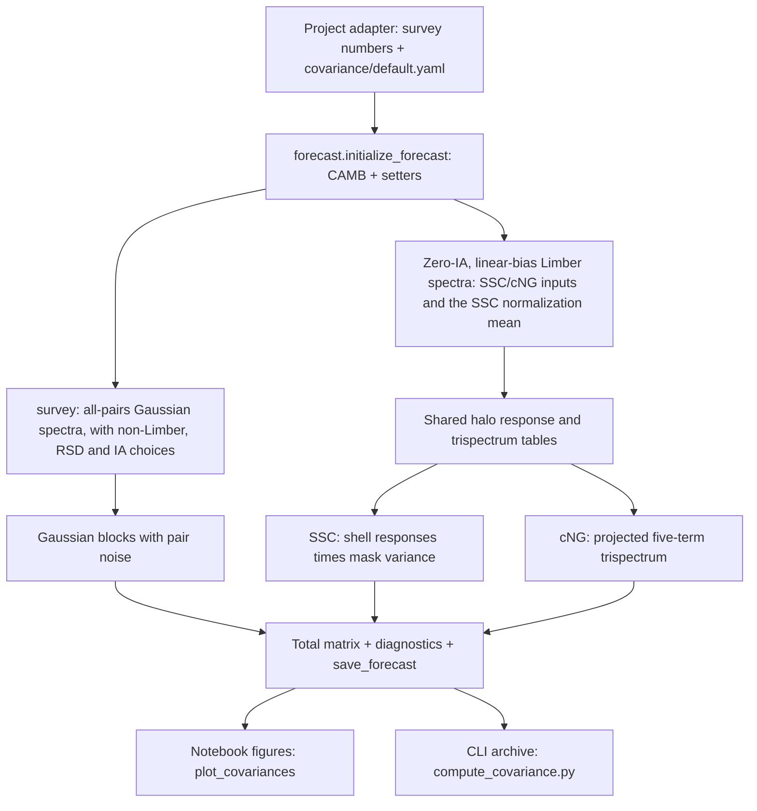

# Table of contents

1. [Covariance tools for notebooks](#covariance_tools_for_notebooks)
2. [Files](#files)
3. [Array and unit conventions](#array_and_unit_conventions)
4. [Gaussian projection](#gaussian_projection)
5. [Halo responses and SSC](#halo_responses_and_ssc)
6. [Real-space and Fourier assembly](#real_space_and_fourier_assembly)
7. [One accuracy boost](#one_accuracy_boost)
8. [Interpolation and numerical checks](#interpolation_and_numerical_checks)
9. [Gaussian physics in notebooks and YAML](#gaussian_physics)
10. [Survey masks and cluster-count area](#survey_geometry)

# Covariance tools for notebooks 

This package prepares inputs for Cocoa's covariance components and assembles
requested matrix blocks. The caller supplies its initialized project
interface; the package never imports a survey's compiled module. Forecast
assembly does not load likelihood data. The separate comparison reader loads
a supplied covariance only when requested by the notebook. Each project
supplies an `EXAMPLE_EVALUATE_COVARIANCE.ipynb` and an
`EXAMPLE_EVALUATE_COVARIANCE.yaml` for its standalone Python runner.

The CLI and notebook share this Python assembly and the same numerical C
code. CLI runs select `backend=ci.covariance`, the direct production
bindings. Notebook calls default to the Armadillo wrappers, exposing
intermediate steps for exploration.

The compiled interface must have covariance generation enabled. Cocoa's
per-project `IGNORE_COSMOLIKE_<PROJECT>_COVARIANCE=1` options omit it by
default. Follow the project's README to unset its key and recompile, then
restart the notebook kernel. The imported module's `has_covariance` attribute
reports its build mode; changing the environment alone cannot change an
already compiled or imported module.

A covariance describes the joint scatter of measured two-point functions.
The Gaussian part follows from pairs of power spectra. Connected
non-Gaussian covariance (cNG) describes the remaining connected four-point
function; super-sample covariance (SSC) describes changes caused by matter
fluctuations larger than the survey. See
[Krause & Eifler](https://arxiv.org/abs/1601.05779),
[Takada & Hu](https://arxiv.org/abs/1302.6994), and the
[C implementation and physics guide](../../cosmolike/covariances/README.md).

The whole workflow, from a project's inputs to a saved forecast:

The two spectrum branches are deliberately distinct. The non-Limber,
RSD, IA and one-loop bias choices extend the Gaussian spectra and the
saved Gaussian mean only; SSC and cNG, including the survey-mean
normalization of SSC, always use the zero-IA, linear-bias Limber
snapshot ([details below](#gaussian_physics)). Requesting an extended
Gaussian model therefore does not add matching SSC/cNG physics.

## Files 

| File | Calculation and responsibility |
| --- | --- |
| `command_line.py` | Read a Cobaya-style evaluate YAML, select the production backend and save a complete covariance. |
| `power.py` | Fill nested, dense linear/nonlinear/cb log-power tables with natural cubic interpolation before C linear lookups. |
| `accuracy.py` | Refine interpolation grids and multipole cutoffs with `accuracy_boost`; choose quadrature rules independently with `integration_accuracy`. |
| `gaussian.py` | Batched all-pairs Limber spectra, complete Wick pairings, conversion of source spectra to observed shear, rectangular Gaussian projection, and real-space pair noise. `shear_gaussian` is the shared small single-source example. |
| `geometry.py` | Convert number densities to noise powers, read raw survey-mask power and pair counts, construct a spherical-cap spectrum, and resolve nearly opposite wavevectors with a planar angular quadrature. |
| `halo.py` | Arrange physical power and halo moments for the five trispectrum contributions and isotropic density response. The combined matter prescription requires massless neutrinos. |
| `forecast.py` | Initialize a project forecast, bind survey settings, compute either space and save arrays with resolved settings. |
| `survey.py` | Assemble real/Fourier G, SSC and cNG matrices with all cross-bin blocks with Gaussian non-Limber/NLA/TATT options and separate zero-IA Limber SSC/cNG. |
| `survey_cluster.py` | Prepare the joint cluster row layout, absolute count densities, normalized cluster windows and every internal cluster cross spectrum. |
| `forecast_cluster.py` | Assemble the joint angular forecast with count Poisson noise, common SSC, biased-tracer cNG and the optional Y transformation. Archive its omitted physics with the result. |
| `counts_cluster.py` | Integrate supplied selected abundances into count means, Poisson noise and SSC. Project the separate non-SSC count–matter-spectrum cross terms from selected halo moments. This is not a full cluster forecast. |
| `transform_cluster.py` | Apply the cluster-lensing localization to both sides of a supplied joint covariance, including every count and two-point cross block. |
| `sampling.py` | `DenseLogTable`: coarse exact samples → cubic construction of a dense uniform log-k table → linear lookup by arithmetic index. Signed quantities remain signed. |
| `likelihood.py` | Read a dataset's total covariance and scale-cut mask; select identical entries from computed components and the supplied matrix, retaining original indices. |
| `diagnostics.py` | Check symmetry, diagonal variances, raw/correlation eigenvalues and generalized covariance ratios. No clipping or diagonal correction is applied. |
| `reference/` | Independent NumPy/SciPy/mpmath algorithms for component tests. Production assembly never calls these oracles. |
| [`../plot_covariances.py`](../plot_covariances.py) | Matplotlib correlation comparisons, component maps/histograms and scale-dependent standard deviations. |

Project folders own survey numbers, redshift files, cosmology, nuisance
parameters, initialization and numerical settings. Copy that small adapter
when enabling another project; reuse these calculations and plotters.
The component bindings require a project interface built with the shared
covariance C/C++ sources.

## Array and unit conventions 

Fields are numbered from zero, with lenses preceding sources. Supplied
signal matrices use `[multipole, field, field]`; noise is a separate
`[field]` array. A covariance between measured AB and CD needs AC, BD, AD
and BC, including cross-bin spectra excluded from the data vector.
Catalog shot noise is $`1/n`$; source shape noise is
$`\sigma_\epsilon^2/n`$, with $`n`$ per steradian and dispersion per component.

A small example fixes the index conventions. Take two lens bins and
one source bin: the fields are $`g_0`$, $`g_1`$, $`s_0`$ with IDs 0, 1,
2. A measured observable is a row `(probe, A, B)` of the table built by
`survey.observable_rows`, with probe IDs 0 xi+, 1 xi-, 2 gamma_t and
3 w(theta): the row (2, 0, 2) is tangential shear around lens bin
$`g_0`$ measured with source $`s_0`$. Each row holds its angular bins
consecutively, so if that row sits at position $`r`$ and every row has
$`n_{\rm bin}`$ angular bins, its measured entries occupy the flattened
indices $`i=r\,n_{\rm bin}+b`$ for bins $`b=0,\ldots,n_{\rm bin}-1`$,
and the covariance is an
$`[n_{\rm row}n_{\rm bin},\,n_{\rm row}n_{\rm bin}]`$ matrix. Fourier
forecasts measure E-mode band powers and drop the xi- rows (probe 1),
so no shear measurement enters twice. Now compare row (2, 0, 2) with
(2, 1, 2): their Gaussian covariance pairs the four fields as
(AC)(BD) and (AD)(BC) and therefore needs the internal
$`g_0g_1`$ spectrum, although no $`g_0g_1`$ clustering row is
measured. This is why the supplied signal cube carries every field
pair.

The component `interface.covariance_*` calls accept `float64` arrays
(field/band IDs use `int32`). C-order, Fortran-order, sliced and read-only
inputs keep their original values and layout.

We chose Armadillo to make the Python notebook API easy to develop and use.
This C++ library provides vectors, matrices and three-dimensional arrays
(cubes) for thin notebook wrappers. pybind11 exposes their functions to
Python, and CARMA converts between Armadillo and NumPy arrays.

Returned NumPy arrays have independent storage and may use Fortran order.
Their axes remain as documented, and the values survive later interface
calls or cosmology changes. Numerical work stays in the shared C kernels.

The production `ci.covariance` submodule instead requires C-contiguous
`float64` inputs (`int32` for IDs). It borrows them without an Armadillo
copy and returns owned C-order arrays. Its kernels and physical axis
conventions are the same as the notebook wrappers.

Two unit boundaries meet in this package. The CAMB initialization
tables store $`\log_{10}[k/(h/{\rm Mpc})]`$ and
$`\ln[P/({\rm Mpc}/h)^3]`$; `power.refine_power_tables` subdivides
that sampling and changes neither the units nor CAMB's physical
wavenumber range. The covariance component arrays instead use
$`c/H_0 = 2997.92458\ {\rm Mpc}/h`$ as the length unit: distances in
$`c/H_0`$, wavenumbers in its inverse, and matter power in
$`(c/H_0)^3`$. Thus
$`k_{\rm core}=2997.92458\,k_{h/{\rm Mpc}}`$ and
$`P_{\rm core}=P_{({\rm Mpc}/h)^3}/2997.92458^3`$ before a core
power/halo call. Angles are radians and survey
areas steradians; project adapters make the conversion from arcminutes
and square degrees explicit.

## Gaussian projection 

`gaussian_block` receives complete spectra, noise, four field IDs and
left/right operators. Each output is the sum of left operator × harmonic
covariance × right operator. Rectangular inputs support independently
requested subblocks; Python can later assign these to MPI processes.
C uses OpenMP within a process and never calls MPI. BLAS stays at one thread.

`realspace_block` treats pure white noise separately. Its infinite
multipole sum becomes a pair-count expression in angular space; using
that expression avoids losing noise power above a finite multipole cutoff.
Signal and mixed signal-noise retain the supplied finite multipole sum.
Both sides must use the same disjoint angular bins and footprint.

For a mask, the raw angular power has monopole
$`C_0^W=\Omega_s^2/(4\pi)`$, where $`\Omega_s`$ is the survey area in
steradians. `cap_mask` is an illustrative footprint, not an
approximation to every survey. `covariance_mask_pair_area` and
`covariance_ssc_mask_variance` both use this raw normalization.

## Halo responses and SSC 

`halo_trispectrum` retains 1-halo, 2-halo (1+3), 2-halo (2+2), 3-halo
and 4-halo terms separately. `halo_power_response` returns a dimensional
isotropic $`dP/d\delta_b`$ using the fractional halo response transferred
to the supplied nonlinear power. This halo approximation is not a
calibration of nonlinear tidal responses or a massive-neutrino model.

The component interface accepts that response through
`covariance_ssc_shell_response`, along with common radial windows and the
projected catalog-mean response. `covariance_ssc_mask_variance` supplies
the long-mode Limber background strength, with units of length. Multiplying
it by the radial integration weight and contracting common shell responses
with `covariance_project` gives the SSC matrix. Keep every cross-lens
block. Removing selected cross correlations can make a covariance indefinite.

## Real-space and Fourier assembly 

`survey_cluster.selected_windows` distinguishes counts from density
contrasts. A shell contains $`dN_i=\Omega_s f_K^2 n_i\,d\chi`$ objects,
where $`n_i`$ includes the observed redshift and richness selections.
The normalized window is $`q_i=f_K^2 n_i/\bar n_i`$, with
$`\bar n_i=\int f_K^2 n_i\,d\chi`$ per steradian. Thus a count retains
its absolute abundance, while $`\int q_i\,d\chi=1`$ for clustering.
The fixed-selection response uses $`n_i b_i`$, where $`b_i`$ is the
selected halo bias. See [To et al., Sec. 4.1](https://arxiv.org/abs/2008.10757).

`all_pairs_spectra` combines the ordinary galaxy/shear fields with all
cluster categories. Cluster clustering and cluster–galaxy spectra use
biased nonlinear matter power; cluster lensing also includes the selected
halo's own mass profile. Noise remains separate. The field order is
galaxies, clusters, then sources; cluster categories run through richness
inside each observed redshift bin. `observable_layout` supplies the
measured rows and the positions of counts in the joint vector. Cross-bin
spectra needed by Gaussian pairings remain available even when they are
absent from that measured row list. These helpers prepare inputs; they
do not by themselves compute a complete cluster covariance.

`forecast_cluster.compute_forecast` combines these inputs into the full
angular matrix. Its cNG approximation multiplies the matter trispectrum
by one linear bias per density leg; count cross terms contain SSC only.
Selected-cluster one-halo cNG corrections and non-SSC count–spectrum
terms remain outside this forecast. Every output records those omissions.
For an executable example and its physical choices, use the
[DES cluster guide](../../../../../projects/des_cluster/covariance/README.md#joint).
The result includes count means and positions, all six two-point families,
separate components, and the optional Y transformation on every cross block.
`valid_indices` excludes only its defined last-bin null modes. Numerical
and Fisher convergence, physical scale cuts and the omitted terms still
need assessment before inference.

For cluster counts, `count_statistics` integrates supplied selected
abundances and their long-mode responses. It returns count means,
Poisson noise, count SSC and optional count–two-point SSC separately.
`count_matter_cross` adds the non-SSC cross correlation with projected
matter spectra, returning separate one- and two-halo terms. It receives
the selected moments from `interface.covariance_cluster_moments`, along
with the same radial selection, distances, matter windows and spin
conventions. Its two-halo term contains the full-population moment
$`I_{11}`$, not another selected cluster moment. See
[Schaan, Takada & Spergel, Eq. 35](https://arxiv.org/abs/1406.3330).

This cross-spectrum helper covers matter/shear fields and a constant
linear-bias galaxy approximation. It does not supply discrete cluster
legs or shared-object noise terms. A full cluster joint matrix also
needs cluster SSC/cNG, count–cluster-spectrum terms, consistent catalog
normalizations and the project's estimator transforms.

Cluster lensing can be localized. Two distinct objects carry that
idea, so this guide keeps separate symbols for them. The physical
surface-density statistic is
$`Y(R)=\Sigma(R)-\Sigma(R_{\max})`$: it removes the dependence on mass
interior to the measured radius. What the forecast transforms is the
represented angular statistic $`y_\gamma=A\,\gamma_t`$, with $`A`$ the
project's dimensionless angular operator acting on the
tangential-shear bin means. In the illustrative single-lens-plane
limit with one constant critical surface density, where
$`\gamma_t=\Delta\Sigma/\Sigma_{\rm crit}`$, linearity gives
$`y_\gamma=Y(R)/\Sigma_{\rm crit}`$: the $`\Sigma_{\rm crit}`$ factor
stays in the normalization, and $`y_\gamma`$ is dimensionless because
$`A`$ acts on shear without converting it to a surface density. For a
broad lens and source stack the geometric factor need not separate
into one common constant, and the supplied angular operator acts
directly on the predicted shear. A single lens plane with
radius-independent source weights can still use an effective inverse
critical density averaged over those weights; the operator, not
either limit, defines the statistic. If a mean vector
changes as $`y=A x`$, its covariance changes as $`C_y=A C_x A^{\mathsf T}`$.
Here $`A`$ acts on cluster-lensing angular rows and leaves the other
measurements unchanged. Consequently a count–lensing block receives one
transformation, and a lensing–lensing block receives two. See
[Park, Rozo & Krause, Eqs. 9–12](https://arxiv.org/abs/2004.07504) and
[the DES covariance model, Sec. II.4](https://arxiv.org/abs/2503.13631).

`transform_cluster.py` receives the same angular operator used by the
project's mean calculation, and applies that supplied operator and
nothing else: the output keeps the representation and units of the
supplied shear rows (the dimensionless angular bin means of the
forecast), with no critical-surface-density factor and no conversion
from angle to physical radius. The surface-density identity above
motivates the localization; the project's operator sets what the
transformed statistic represents. Supply every unmasked angular bin: the
derivative stencil can read neighboring bins outside the final scale
selection. The last output bin of $`y_\gamma`$ is exactly zero by
construction: the operator subtracts the outermost retained bin's
estimate from itself, the angular analogue of
$`Y(R_{\max})=\Sigma(R_{\max})-\Sigma(R_{\max})=0`$. It is a
constructed zero, not a measured zero signal. That known null mode
remains in the returned matrix. Apply the likelihood's selection
afterwards; no eigenvalue correction is part of the transformation.

`survey.realspace_covariance` and `survey.fourier_covariance` receive an initialized project interface,
resolved integration settings, the observable row map and catalog noise.
It returns separate Gaussian, SSC, cNG and total matrices, the projected
mean signals and elapsed times by calculation stage. CAMB setup, output
writing and eigenvalue diagnostics remain outside this function.
`survey.observable_rows` puts angular bins inside each tomographic row,
with xi+, xi-, galaxy--shear and galaxy clustering in that order.
Fourier rows measure E-mode spectra. Real-space xi+ and xi- use distinct
angular kernels and, for TATT, include B modes with opposite signs.
Integer band endpoints are inclusive, and each multipole
receives weight proportional to its mode count, $`2\ell+1`$. Refinement
holds those endpoints fixed so it compares the same measurement.

Fourier means average the core angular spectra directly. Real-space
means retain Cocoa's extra source-leg factor when using unit-normalized
spin kernels. The chosen convention is applied consistently to Gaussian,
SSC and cNG signals; white noise receives neither conversion.
The low-level supplied-spectrum wrappers let users state their own field
conventions explicitly; see their Python `help(...)` documentation.

The supported model uses massless neutrinos, linear galaxy bias, zero
magnification and a spherical-cap or supplied binary-mask footprint. Gaussian spectra have
the [non-Limber, RSD and IA choices](#gaussian_physics)
described below; SSC/cNG retain zero RSD, zero IA and Limber
projection. Optional
per-lens-bin `bias2` and `bias_s2` settings (quadratic and tidal bias,
default zero) add the Limber one-loop galaxy-bias terms of the core
C-FAST-PT to the Gaussian spectra and the mean signal only; SSC/cNG keep
linear bias.

SSC uses the isotropic fractional halo response transferred
to the chosen nonlinear matter power, with galaxy survey-mean subtraction.
The five halo cNG contributions are projected with every cross-lens block
retained. These approximations define a forecast; they do not reproduce
all physical choices of a supplied likelihood covariance.

The costly matter trispectrum depends on distance and two wavenumbers,
not on the observed catalog pair. The assembler computes it once per
radial shell and shares it across all catalog pairs. Its multipole table
is linearly interpolated in ln(ell+1/2), preserving signed values. The
angular kernels still sum every integer multipole: the code first projects
the interpolation weights, then contracts the smaller trispectrum table.
This is algebraically the same angular projection of the interpolated
table. Refining the coarse table is still necessary to test its accuracy.

`survey.project_connected` then applies every catalog's radial window.
Its compiled `covariance_project_connected` wrapper accepts the transformed
matter table, the pair windows and a common radial measure. It returns the
complete connected matrix and shares each angular block's matter weights
across catalog pairs. Every radial sum keeps its node order regardless of
the OpenMP thread count. The low-level call is also available for supplied
matter tables; use `help(interface.covariance_project_connected)` for its
array shapes and units.

Numerical controls for this low-level assembly are explicit in its
function documentation. The notebook's full G+SSC+cNG accuracy boost is
not a certified inference setting. Complete matrices must pass positivity
checks and resolution/Fisher comparisons before use for inference.

## One accuracy boost 

Each project stores its integration baseline in `covariance/default.yaml`.
The notebook reads it through the project's `configuration` function.
`accuracy_boost=1` means that project baseline; small grids used only to test
program wiring belong in tests. The project README records the numerical
refinements used to assess its defaults.

The global boost multiplies every internal table refinement. For example,
`non_gaussian_accuracyboost: 3` and `window_accuracyboost: 2` give effective
factors 6 and 4 when only `accuracy_boost` changes from 1 to 2. The global
boost also increases signal/mask cutoffs and divides the response derivative
step. Physical bins, their Fourier-band endpoints, survey densities and
CAMB inputs remain fixed.

| Base control | Quantity refined by the global boost |
| --- | --- |
| `ell_max`, `mask_ell_max` | Signal and footprint harmonic cutoffs |
| `ng_ell_intervals`, `non_gaussian_accuracyboost` | Intervals in the shared matter-response/trispectrum table |
| `window_accuracyboost` | 16,384 intervals in each lensing-efficiency table |
| `core_accuracyboost` | Shared halo/profile reader table resolution |
| `power_accuracyboost` | Subdivisions of each original CAMB log-k interval; default 8 |
| `response_step` | Half-width of the centered derivative in ln(k); divided by the boost |

The default power refinement turns 1,500 original CAMB wavenumbers into
11,993 samples for every covariance component. At global boost 2 it gives
23,985 samples, retaining every boost-1 node. `power.py` interpolates ln(P)
with a natural cubic spline at each fixed redshift; the hot C readers keep
their linear interpolation. This changes neither CAMB parameters nor its
physical wavenumber range. Reinitialize the forecast after changing the
power refinement; the example notebooks do this for each boost.

The returned settings retain both `accuracy_parameters` (the base controls)
and the effective node counts and grids. Internal controls can be varied one
at a time when diagnosing convergence, for example
`survey.configuration(accuracy_boost=1, non_gaussian_accuracyboost=3)`.
Supported global values are 1, 2, 4 and 8.

Quadrature has its own independent control, `integration_accuracy`.
Levels 0 through 7 select Gauss-Legendre rules of 96, 128, 256, 512,
1024, 2048, 4096 and 8192 nodes per panel. GSL stores the rules
through 1024 nodes and generates the nodes of the three larger ones;
both kinds are supported, as in the
[C guide](../../cosmolike/covariances/README.md#operators). Raising
the global boost leaves the selected rule unchanged: integration order
and interpolation refinement are independent controls.
The same choice controls radial, halo-mass and relative-angle integrals,
angular-bin averages, and selected-cluster profile responses. Wide angular
bins are split into panels to resolve their high-multipole oscillations.
Low-level tests may also use the stored 64-node rule, and the smooth
low-mass Wynn tail has its own 32-4096 ladder; sizes outside these
ladders are rejected. Compare, for example,
`survey.configuration(accuracy_boost=1, integration_accuracy=1)` with the
level-zero baseline to isolate quadrature refinement, and scan
successive levels until the matrix stabilizes before accepting a
project default; the ladder above level 4 exists exactly for such
checks. Hold interpolation settings fixed during
this scan, then test their refinement separately. Save Gaussian, SSC and
connected terms as well as the total matrix, so cancellations between terms
cannot conceal a numerical error.

Numerical convergence must be measured for the intended
physical model; matching a data-vector cutoff does not certify a covariance.

The interpolation grids retain their old nodes when the boost doubles.
For example, a table with 16 points has 15 intervals; splitting each
interval gives 31 points. Using 32 points across the same range would move
every interior node. A linear interpolant then changes where its slope
jumps, which can make the error oscillate as resolution increases.

The resolved `ng_ell` array contains the matter-response and trispectrum
samples. Its spacing is uniform in $`\ln(\ell+1/2)`$. When the signal cutoff
grows, the table extends on the same grid instead of stretching existing
intervals. The last table node may lie beyond that cutoff to bracket the
last signal mode; it does not add modes to the observable. Fourier forecasts
trim unused upper samples without moving the remaining nodes. The saved
settings include the actual array, so the interpolation grid is reproducible.

This node-retention rule applies to interpolation tables. Gauss–Legendre
quadrature nodes and weights change together when its order increases;
they are tested separately. Nested sampling also does not guarantee
monotonic convergence of every covariance entry. Compare several boosts,
including the highest affordable pair, and isolate individual grids if
convergence stalls. CAMB inputs stay fixed in this covariance-only test;
their sampling needs a separate refinement check before inference.

Spectrum preparation processes independent multipoles in bounded batches.
Every batch uses the complete radial quadrature and all field pairs, so it
preserves the individual sums and introduces no additional interpolation.
This bounds temporary memory when both the multipole cutoff and radial
resolution grow at high boost.

## Interpolation and numerical checks 

Sample expensive quantities at **fixed physical wavenumber** before
constructing a `DenseLogTable`. Cubic interpolation only builds its dense
table. Repeated queries read adjacent entries linearly; queries outside
the sampled range fail explicitly. Increase both coarse and dense counts,
and compare off-grid values to direct calculations. Increasing dense
sampling cannot restore a feature missing from coarse samples.
On a fixed interval, refine the number of intervals: use
`2*(ndense-1)+1` points when doubling resolution. Preserve the coarse sample
nodes as well. Increasing both point counts without checking their positions
can change the interpolation error instead of steadily resolving it.

A positive diagonal or a few positive subblocks is insufficient. Check
the complete total matrix, any selected likelihood matrix, and complete
cross-block coverage. An individual cNG contribution need not itself be
positive definite. Generalized eigenvalues bound variance changes across
all directions, but final accuracy should be assessed with parameter
errors and marginalized Fisher Figures of Merit at representative
cosmologies. The data-vector $`|\Delta\chi^2|<0.2`$ rule is not a covariance
convergence criterion.

`covariance_modes` tests positivity using the correlation matrix: each
observable is divided by its own standard deviation. This invertible
change of units preserves the signs of the covariance modes. It is useful
when shear, clustering and counts have very different variances: rounding
in a raw eigensolver can overwhelm the smallest eigenvalues. The function
also returns the raw eigenvalues for inspection. Rescaling neither removes
negative modes nor adds variance to make a matrix pass.

The notebook computes full G+SSC+cNG forecasts in both spaces.
Selected-cluster non-Limber corrections and production FoM convergence
remain separate work.

Selected cluster mass moments are returned by physical name: `density` and
`biased_density` have shape `[state,selection]`; `J01` and `J11` have shape
`[state,selection,k]`; `J02`, `J03_KKQ` and `J03_KQQ` have shape
`[state,selection,kpair]`. The count–matter helper reads `J11` and `J02`
directly. These named results replace packed `single` and `pair` role axes.

## Gaussian physics in notebooks and YAML 

`survey.configuration(gaussian={"nonlimber": True, "ia": "NLA", "A1": 0.6})`
selects non-Limber gg/gs and a constant per-bin NLA amplitude. The CLI reads
the same mapping from `covariance.gaussian`. Use `ia: none` to omit IA;
`ia: TATT` additionally accepts `A2` and `B_TA`. Each amplitude may be a
scalar or a list with one value per source bin. `rsd: true` adds the
lens redshift-space-distortion window to every Gaussian spectrum with a
lens field; the non-Limber correction then carries the matching exact
distortion transfer. A mapping that omits `rsd` resolves to `rsd: false`
when the configuration is built, and the resolved choice is written into
the saved settings; a stored Gaussian model without an `rsd` entry is
refused with an error naming the missing key, never read as false. TATT
requires `rsd: false`, and SSC/cNG never include RSD.

The C kernels own the model calculation. `forecast.py` validates and
installs the amplitudes; `survey.py` selects Gaussian spectra and passes
TATT B modes to the real-space assembler. E-only Fourier measurements
use the E spectra. SSC and cNG keep their zero-IA Limber inputs,
independently of these Gaussian choices; the spectra entering the SSC
survey-mean normalization response also stay Limber.

`nonlimber_lmax` sets the base correction cutoff.
`nonlimber_accuracyboost` multiplies the 4096 logarithmic radial intervals.
The global boost refines the cutoff and grid together, preserving old
radial nodes. `integration_accuracy` independently selects GSL rules.
The low-level `covariance_spectra` exposes the same model for diagnostics.

The joint selected-cluster forecast still requires Limber and zero IA;
it rejects unsupported Gaussian model requests. Its separate galaxy/shear
adapter supports the choices described here.

The shared `precision.py` module implements sample-covariance corrections
and the precision-matrix expansion. It consumes arrays supplied by the
project; it neither loads DES data nor calls a physical model. The DES
`EXAMPLE_COVARIANCE_PME.ipynb` illustrates the analytic-plus-simulation
calculation with an explicitly synthetic covariance ensemble.

## Survey masks and cluster-count area 

A survey area specifies how much sky was observed; it does not describe
holes, disconnected regions or the pairs lost near a boundary. The
optional inputs below let both `forecast.compute_forecast` and
`forecast_cluster.compute_forecast` use more of that information. These
features were adapted from João Rebouças's upstream
[PR 63](https://github.com/CosmoLike/cocoa-cosmolike-core/pull/63) and
[PR 64](https://github.com/CosmoLike/cocoa-cosmolike-core/pull/64).

| Setting | Input and effect |
|---|---|
| `mask_cl` | Raw power of a common binary survey mask, indexed from multipole zero. Replaces the cap spectrum in SSC and in the real-space pure-noise pair areas. |
| `mask_pair_correlation` | One positive, bin-averaged pair-availability factor per angular bin. Replaces the pure-noise pair areas directly; does not change SSC. Real-space forecasts only. |
| `cluster_area_table` | Two columns: redshift and count-survey area in square degrees. Changes the mean counts, Poisson noise and count SSC; the two-point footprint remains unchanged. Joint cluster forecasts only. |

In a notebook, put these inputs into the returned `settings` mapping before
calling `compute`. Read a raw mask spectrum with
`cov.load_mask_cl(filename=mask_file)`: the text file must contain two
columns, contiguous multipoles starting at zero and their raw power.
Use `np.loadtxt` for a count-area table. The command-line covariance YAML
accepts the same three arrays under `covariance:`. They are physical
inputs, so the accuracy boost does not alter their values. The saved
forecast includes the supplied arrays and resolved area.

For a binary mask with solid angle $`\Omega`$, its monopole obeys

$$
C_0^W=\frac{\Omega^2}{4\pi}.
$$

Do not divide the spectrum by this monopole, by area, or by sky fraction.
The area derived from it must agree with `area_deg2` within 0.1%; that
monopole area is then used consistently by all covariance terms. General
object weights do not satisfy this geometric interpretation. The caller
must establish that the mask is binary: the spectrum alone cannot prove
that. A spectrum shorter than `mask_ell_max + 1` is explicitly treated as
band limited and padded with zeros; a longer spectrum is rejected rather
than silently truncated.

The pair factor $`w_W`$ is normalized to the number of pairs expected
without boundary losses. For angular bin $`[\theta_-,\theta_+]`$, its
ordered-pair area is

$$
A_{\rm pair}=\Omega\,2\pi
(\cos\theta_- - \cos\theta_+)\,w_W.
$$

Multiplication by the two catalog densities gives the ordered-pair count.
No additional factor of two belongs here. A measured factor must use this
normalization and these same bin edges; a raw full-sky mask correlation
has a different normalization. The numerical calculation uses the sine
identity for the cosine difference to retain precision in narrow bins.
See [Troxel et al., Eq. 6](https://arxiv.org/abs/1804.10663) for the role
of pair counts in shape-noise covariance. A single supplied factor applies
to every catalog pair; catalog-dependent footprints and nonuniform object
weights need their corresponding pair counts, which this input does not
provide.

A mask-only factor omits the source-clustering contribution in that
paper's Eq. 6. If a measured galaxy-pair factor already includes clustering,
do not multiply by that contribution again.

The signal-signal and mixed signal-noise Gaussian terms retain their
existing area approximation, and cNG retains its inverse-area scaling.
Supplying a mask spectrum does not implement general Gaussian mask-mode
coupling. Supplying measured pairs does not provide an SSC mask: without
`mask_cl`, SSC still uses the cap. Measured pair areas are evaluated
directly, bypassing the harmonic pair reconstruction altogether.

Cluster counts need one further distinction. A depth-limited catalog can
cover less sky at high redshift. Linear interpolation of
`cluster_area_table` supplies that shell's area in both the expected
count and its abundance response. The table must cover every shell with
selected clusters. The count-count SSC uses a cap of that shell's area;
if its area equals the two-point area, it reuses the supplied two-point
mask instead. A zero-area shell contributes no counts.

The count/two-point SSC still approximates the cross-window long-mode
variance by the two-point variance. An area table cannot determine the
actual cross-spectrum of two footprints. Writing the two auto variances
as $`V_N`$ and $`V_2`$, this approximation gives the window matrix

$$
\begin{pmatrix}V_N&V_2\\V_2&V_2\end{pmatrix}.
$$

Its determinant is $`V_2(V_N-V_2)`$. If the count variance is smaller,
the assumed cross term violates the Cauchy bound and the forecast raises
an error. It does not clip the covariance or change an eigenvalue.
Passing this check establishes algebraic consistency, not the accuracy
of the distinct-footprint approximation. The forecast archive records
this omitted cross-spectrum whenever an area table is supplied.
